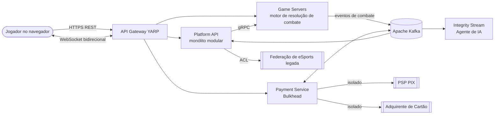

# Rift Arena: FPS Competitivo no Navegador

**Projeto Architectural Kata** | Arquitetura de Software | 6º Período, Engenharia de Software | Turma de Quarta-feira

**Kata de referência:** *Going... Going... Gone!* (Leilões Online em Tempo Real), adaptado para um jogo de tiro competitivo.

Rift Arena é um jogo de tiro em primeira pessoa (FPS) multiplayer que roda direto no navegador. Partidas de "todos contra todos" com até 8 jogadores acontecem em tempo real sobre um servidor autoritativo. Além das partidas casuais, a plataforma organiza **torneios com inscrição paga e premiação** (PIX e cartão), o que torna a integridade das partidas um problema de dinheiro: um agente de IA monitora o fluxo de eventos de combate **durante a partida** para detectar trapaças e **conluio** entre jogadores.

Este repositório contém **somente a arquitetura** do sistema (visão, decisões, modelos e planos de validação). Não há implementação: trechos de código nos documentos são ilustrativos.

## Como o kata foi adaptado

| Going... Going... Gone! | Rift Arena |
|---|---|
| Lances chegando em milissegundos, com ordenação estrita | Disparos chegando em milissegundos, com ordenação estrita: o disparo feito primeiro vence, e quem já morreu não abate ninguém |
| Motor de arremate | Motor de resolução de combate (servidor autoritativo) |
| Canal bidirecional com os participantes | WebSocket binário entre navegador e Game Server; gRPC streaming entre serviços |
| Apache Kafka | Fluxo de eventos de combate, fim de partida e pagamentos |
| Agente de IA para fraude e conluio de lances | Agente de IA para trapaça (aimbot) e conluio (jogadores que se protegem, alimentação de abates para inflar ranking) |
| Gateway de pagamentos PIX/Cartão isolado por Bulkhead | Inscrição em torneios e pagamento de prêmios via PIX/Cartão, isolados por Bulkhead |
| Observer ou Strategy desacoplado do motor de arremate | Observer e Strategy desacoplados do motor de resolução de combate |

## Organização por sprints

Cada pasta reúne os entregáveis produzidos naquela sprint. A arquitetura evolui de uma sprint para a outra; quando há conflito, vale o documento mais recente.

| Sprint | Período (aprox.) | Tema | Entregáveis principais | Pasta |
|---|---|---|---|---|
| 1 | 26/08 a 16/09 | Fundação e visão | Visão, subdomínios, QAW, C4 nível 1 e 2 (v1), ADR-001 | [sprint-1](sprint-1/README.md) |
| 2 | 16/09 a 07/10 | Domínio e design de código | Modelo de domínio, ordenação estrita, SOLID, Observer/Strategy desacoplados do motor, C4 nível 3, ADR-002 | [sprint-2](sprint-2/README.md) |
| 3 | 07/10 a 04/11 | Integração e resiliência | Canal bidirecional, Kafka, mapa de contexto com ACL, Bulkhead PIX/Cartão, C4 nível 2 (v2), ADR-003 e ADR-004 | [sprint-3](sprint-3/README.md) |
| 4 | 04/11 a 02/12 | IA, governança e entrega final | Agente de IA de trapaça e conluio em tempo real, fitness functions, stack final, ADR-005 e ADR-006, documento final | [sprint-4](sprint-4/README.md) |

> As datas são uma sugestão alinhada às datas dos ADRs do template. Ajustem para o calendário real da turma.

## Por onde começar

1. Para a entrega final, leia [sprint-4/README.md](sprint-4/README.md). Ele segue a estrutura do template da disciplina e aponta para todos os documentos de apoio.
2. Para entender a evolução, leia os READMEs das sprints em ordem.

## Visão rápida da solução



## Estrutura

```
fps-kata/
├── README.md                  ← este arquivo
├── sprint-1/                  ← visão, QAW, C4 L1/L2 v1, ADR-001
├── sprint-2/                  ← domínio, ordenação estrita, SOLID, GoF, C4 L3, ADR-002
├── sprint-3/                  ← canal bidirecional, Kafka, DDD + ACL, Bulkhead, ADR-003/004
└── sprint-4/                  ← IA de trapaça e conluio, fitness functions, ADR-005/006, documento final
```
