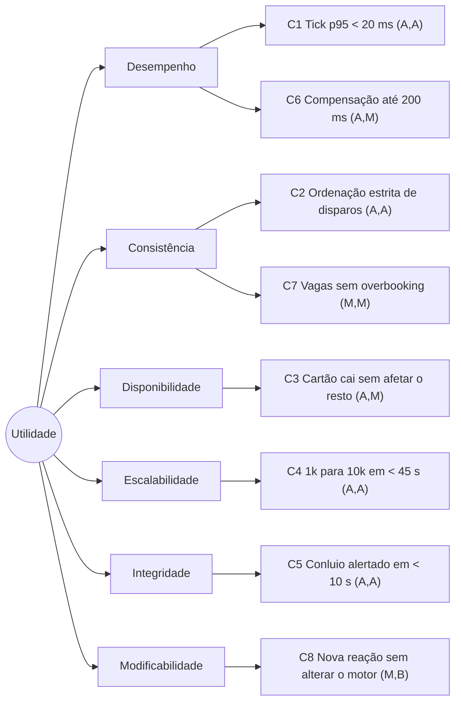

# Quality Attribute Workshop (QAW)

Este documento registra o resultado do QAW realizado pela equipe. Os cenários seguem o formato padronizado de seis partes: **Fonte, Estímulo, Artefato, Ambiente, Resposta e Medida da Resposta**.

## 1. Drivers de negócio

1. **Diversão depende de responsividade.** Acima de ~100 ms de atraso percebido entre clicar e ver o efeito, o jogo parece "travado".
2. **Competição depende de justiça.** Quem atirou primeiro tem que vencer, independentemente do ping, como o lance mais cedo vence no leilão.
3. **Dinheiro exige integridade.** Torneios pagos só têm credibilidade se trapaças e conluios forem pegos antes do pagamento do prêmio.
4. **Eventos geram picos.** Finais de torneio multiplicam o acesso por 10 em poucos minutos, e a abertura de inscrições concentra pagamentos.
5. **Parceria com a federação.** O contrato exige que todo resultado de torneio seja reportado, mesmo que com atraso.

## 2. Cenários de qualidade priorizados

| # | Atributo | Fonte | Estímulo | Artefato | Ambiente | Resposta | Medida |
|---|---|---|---|---|---|---|---|
| C1 | Desempenho / Latência | 8 jogadores numa partida | Enviam entradas e disparos a 30 Hz | Game Server (motor de resolução) | Carga normal (50 partidas por instância) | Processa a entrada, resolve disparos em ordem e envia o snapshot | p95 do tick < 20 ms; entrada até snapshot p95 < 50 ms |
| C2 | Consistência / Ordenação | Dois jogadores | Atiram um no outro no mesmo tick | Motor de resolução de combate | Carga normal | Disparo com instante mais cedo vence; o outro é anulado | 100% dos casos resolvidos de forma determinística e reproduzível em teste |
| C3 | Disponibilidade / Resiliência | Adquirente de cartão | Fica fora do ar ou responde em mais de 10 s | Payment Service | Abertura de inscrições de torneio | Circuit Breaker abre, interface oferece PIX, partidas e PIX seguem normais | 0 impacto em partidas; 0 impacto no fluxo PIX; interface responde em < 1 s com alternativa |
| C4 | Escalabilidade / Elasticidade | Final de torneio | Acessos sobem de 1.000 para 10.000 jogadores em 10 min | Frota de Game Servers | Pico | Autoscaling com buffer de servidores aquecidos | Nova instância em < 45 s; fila p95 < 30 s |
| C5 | Segurança / Integridade | Dois jogadores em conluio numa partida de torneio | Evitam se atacar e encurralam os outros | Agente de IA (fluxo Kafka) | Torneio ao vivo | Alerta ao árbitro com evidências; prêmio retido | Alerta em < 10 s após a janela suspeita; 0 punições automáticas; precisão >= 90% |
| C6 | Justiça (Fairness) | Jogador com 150 ms de ping | Atira num alvo que via na tela | Game Server (compensação de latência) | Produção | O servidor rebobina as posições até o instante visto | Acerto validado para latências de até 200 ms |
| C7 | Consistência | 500 jogadores | Disputam as últimas 10 vagas de um torneio ao mesmo tempo | Módulo Torneios | Abertura de inscrições | Vagas reservadas de forma atômica | 0 vagas vendidas além do limite; 0 cobranças sem vaga |
| C8 | Modificabilidade | Equipe de game design | Pede nova arma, modo ou reação a eventos | Domínio de Combate | Desenvolvimento | Nova classe sem alterar o motor (`Match`) | Esforço < 1 dia; 0 linhas alteradas em `Match`, verificado por fitness function |

## 3. Árvore de utilidade

Prioridade no formato (importância para o negócio, dificuldade técnica), com A = alta, M = média, B = baixa.

Os cenários **(A,A)** são os drivers arquiteturais: C1, C2, C4 e C5.

## 4. Trade-offs identificados

| Trade-off | Decisão | Consequência aceita |
|---|---|---|
| Consistência x Latência | Servidor autoritativo com predição no cliente | O cliente às vezes corrige a própria posição, em troca de nenhuma trapaça de posição. |
| Ordenação perfeita x Latência | Ordenação estrita **dentro do tick** (33 ms) | Disparos são resolvidos com até 33 ms de atraso, mas sempre na ordem correta. |
| Justiça para quem atira x para quem é atingido | Compensação de latência limitada a 200 ms | "Morri atrás da parede" pode acontecer por alguns milissegundos. |
| Precisão da IA x Custo x Tempo | Model tiering e janelas deslizantes | Casos óbvios são decididos em segundos sem LLM; os ambíguos levam um pouco mais. |
| Isolamento x Simplicidade | Payment Service separado | Um deploy a mais, em troca de isolamento físico e escopo PCI reduzido. |
| Entrega síncrona x Garantia de entrega | Federação recebe resultados de forma assíncrona | O resultado oficial pode chegar com minutos de atraso ao parceiro. |

## 5. Riscos levantados

| Risco | Probabilidade | Impacto | Mitigação |
|---|---|---|---|
| Garbage collector causar picos no tick | Média | Alto | Evitar alocações no laço, Server GC, medir p99 do tick |
| Banda de saída cara no pico | Média | Médio | Serialização binária e envio de deltas |
| Falsos positivos de conluio (amigos que se encontram por acaso) | Média | Alto | Humano no circuito, evidência acumulada em várias partidas |
| Fraude de pagamento (chargeback após a partida) | Média | Médio | Antifraude da adquirente, PIX preferencial, prêmio retido por 48 h |
| Federação mudar o contrato XML | Baixa | Médio | ACL isola o impacto num único adaptador |
