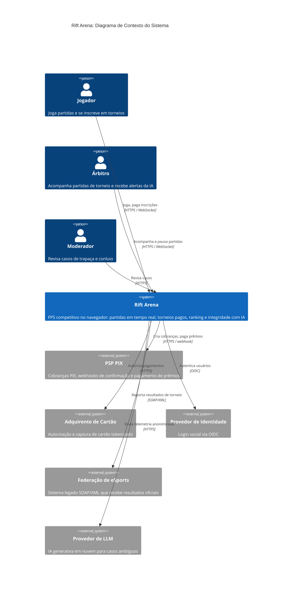

# C4 Nível 1: Diagrama de Contexto

Mostra o Rift Arena como uma caixa única, quem o usa e com quais sistemas externos ele conversa.

## Elementos

| Elemento | Tipo | Descrição |
|---|---|---|
| Jogador | Pessoa | Usuário final, desktop com teclado e mouse (Pointer Lock API). |
| Árbitro | Pessoa | Equipe de torneios. Recebe alertas ao vivo e pode pausar uma partida. |
| Moderador | Pessoa | Equipe de operação. Decide sobre casos de trapaça e conluio. |
| Rift Arena | Sistema | O sistema em construção. |
| PSP PIX | Externo | Provedor de serviços de pagamento com API PIX. Subdomínio genérico. |
| Adquirente de Cartão | Externo | Processa cartões; o número do cartão é tokenizado no navegador e nunca toca nossos servidores. |
| Provedor de Identidade | Externo | Keycloak federado com Google e Discord. |
| Federação de eSports | Externo (legado) | SOAP/XML, janela de manutenção semanal, instável. |
| Provedor de LLM | Externo | Usado apenas no tier 2 da IA, com dados anonimizados. |
