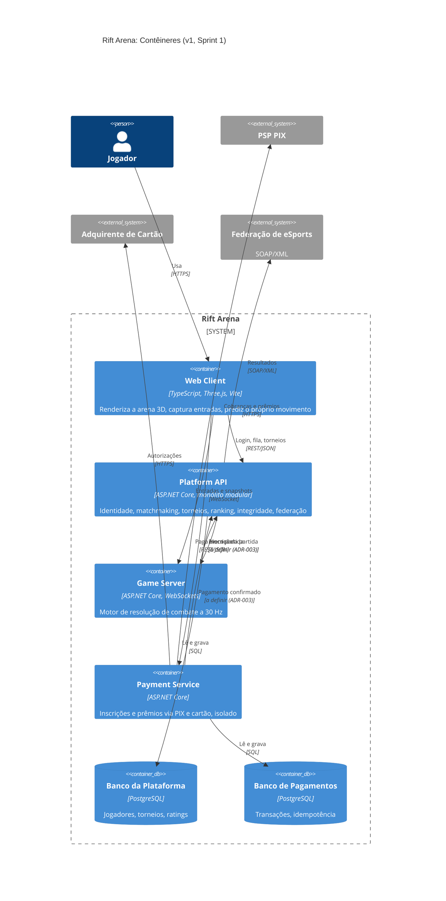

# C4 Nível 2: Diagrama de Contêineres (versão 1)

Primeira versão, derivada do ADR-001. Mostra os três artefatos de deploy: Platform API (monólito modular), Game Server e Payment Service. Gateway, Kafka e IA entram nas Sprints 3 e 4 (versão final em `sprint-4/docs/c4/c2-containers-final.md`).

## Contêineres

| Contêiner | Tecnologia | Responsabilidade | Escala |
|---|---|---|---|
| Web Client | TypeScript, Three.js, Vite | Renderização, entrada, predição, interpolação | CDN (estático) |
| Platform API | ASP.NET Core | Regras de negócio fora da partida | Horizontal, sem estado |
| Game Server | ASP.NET Core + WebSockets | Motor de resolução, estado em memória | Horizontal por partidas, com estado |
| Payment Service | ASP.NET Core | Orquestração de pagamentos, isolada | Horizontal, sem estado |
| Bancos | PostgreSQL | Persistência (bancos separados para pagamentos) | Primário + réplica |

## Pontos em aberto (levados para as próximas sprints)

- Protocolos entre os contêineres e broker de mensagens: ADR-003.
- Ponto único de entrada para o cliente (gateway): ADR-005.
- Onde roda o agente de IA e como ele recebe eventos em tempo real: ADR-006.
