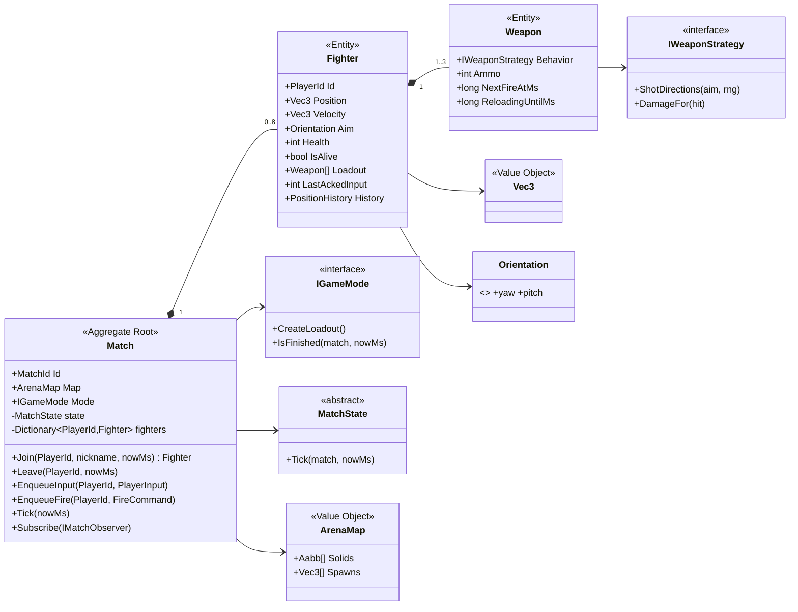
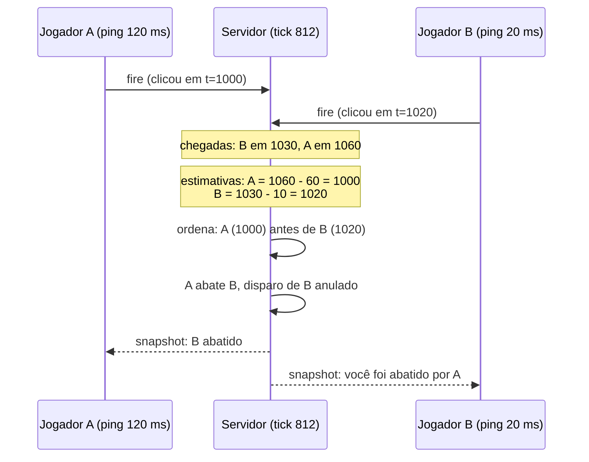
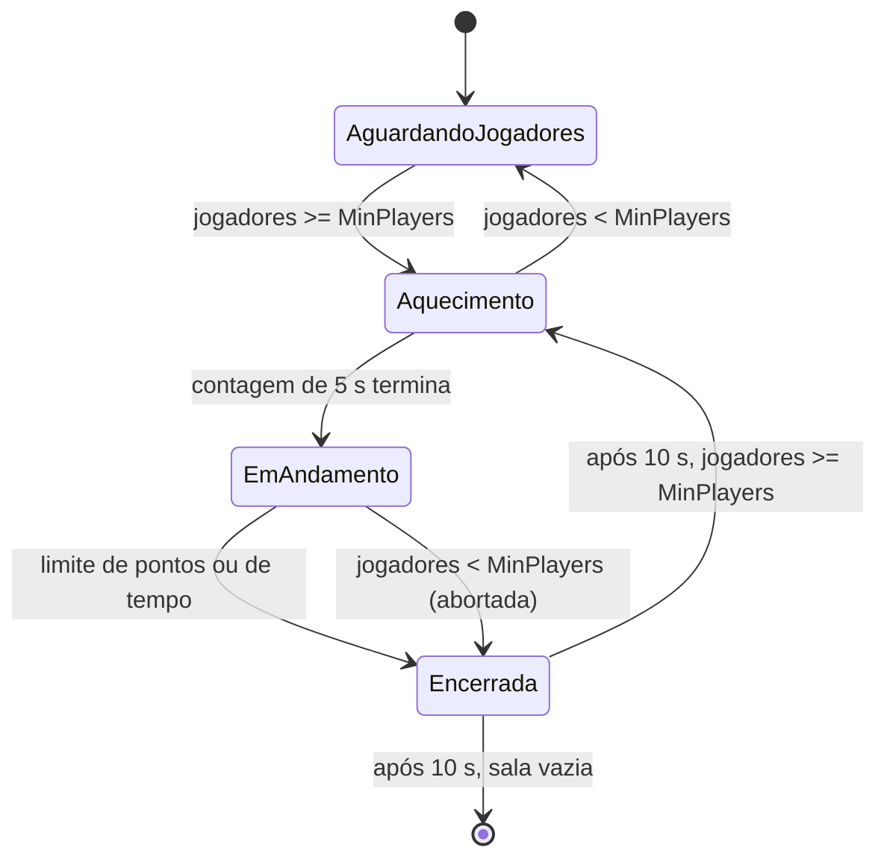

# Modelo de Domínio: Resolução de Combate (Core Domain)

## 1. Linguagem ubíqua

Termos usados igualmente por game designers, desenvolvedores e documentação. O código usa os nomes em inglês da coluna "No código".

| Termo | No código | Definição |
|---|---|---|
| Partida | `Match` | Uma sessão de jogo numa arena, com modo, jogadores e ciclo de vida. Raiz de agregado. |
| Arena | `ArenaMap` | Geometria estática da partida: blocos sólidos e pontos de nascimento. |
| Combatente | `Fighter` | Um jogador dentro de uma partida (posição, vida, placar, armas). |
| Tick | `Tick` | Um passo da simulação (1/30 s). |
| Entrada | `PlayerInput` | Intenção do jogador num tick: andar, pular, para onde olha. Tem número de sequência. |
| Disparo | `FireCommand` | Intenção de atirar, com a direção da mira no instante do clique. |
| Disparo instantâneo | Hitscan | Disparo resolvido como um raio, sem projétil viajando. |
| Rebobinar | Rewind | Voltar as posições dos alvos ao instante que o atirador via, para resolver o disparo (compensação de latência). |
| Abate | `Kill` | Quando a vida de um combatente chega a zero por dano de outro. |
| Renascer | Respawn | Voltar à arena num ponto de nascimento após um abate. |
| Arma | `Weapon` | Instância de arma de um combatente: munição, recarga, cadência. |
| Comportamento de arma | `IWeaponStrategy` | Regras da arma: dano, dispersão, projéteis por tiro, queda de dano. |
| Modo de jogo | `IGameMode` | Regras de vitória e equipamento inicial (Deathmatch, Instagib). |
| Fase | `MatchPhase` | Estado do ciclo de vida: Aguardando, Aquecimento, Em andamento, Encerrada. |
| Placar | `Scoreboard` | Abates, mortes e pontos de cada combatente. |
| Snapshot | `Snapshot` | Foto do estado da partida enviada aos clientes a cada tick. |
| Confirmação | Ack | Último número de sequência de entrada processado para um jogador. |
| Telemetria de combate | `CombatTelemetry` | Dados por disparo usados pelo anti-cheat (precisão, giro da mira, distância). |
| Motor de resolução | `Match.ResolveFireCommands` | Parte do agregado que ordena e resolve os disparos de um tick (equivalente ao motor de arremate do kata). |
| Instante do disparo | `ShotTimeMs` | Momento estimado em que o jogador clicou, no relógio do servidor: chegada menos metade do RTT. |
| Disparo anulado | `VoidedShot` | Disparo descartado porque o atirador já havia sido abatido por um disparo anterior no mesmo tick. |
| Interação entre pares | `PairInteraction` | Resumo de quanto dois combatentes se atacaram e quanto tempo passaram próximos sem se atacar (base da detecção de conluio). |

## 2. Agregados, entidades e objetos de valor

### Por que `Match` é a raiz de agregado

Um disparo envolve dois combatentes (atirador e alvo), a arena (paredes bloqueiam o tiro) e a fase da partida (no aquecimento não há dano). Todas essas regras precisam ser verificadas de forma atômica dentro de um tick. Por isso combatentes não são agregados independentes: só são alterados através de `Match`.

## 3. Invariantes do agregado `Match`

| # | Invariante | Onde é garantida |
|---|---|---|
| I1 | No máximo `Mode.MaxPlayers` combatentes (8). | `Match.Join` |
| I2 | Dano só é aplicado na fase Em andamento. | `MatchState.AllowsCombat` |
| I3 | Um combatente morto não se move nem atira até renascer. | `Match.Tick` |
| I4 | Uma arma não dispara antes de `NextFireAtMs` nem durante a recarga. | `Weapon.TryFire` |
| I5 | No máximo 3 entradas por combatente são processadas por tick (anti speedhack). | `Match.Tick` |
| I6 | Rebobinamento limitado a 200 ms no passado. | `LagCompensator` |
| I7 | Velocidade horizontal nunca excede `MoveSpeed` (7 m/s). | `FighterMovement.Step` |
| I8 | A partida termina quando um combatente atinge o limite de pontos ou o tempo acaba. | `IGameMode.IsFinished` |
| I9 | Disparos de um tick são resolvidos em ordem estrita de `ShotTimeMs`; empate desfeito pelo número de sequência de chegada no servidor. | `Match.ResolveFireCommands` |
| I10 | Um combatente abatido por um disparo anterior no mesmo tick tem os disparos seguintes anulados (sem abate póstumo). | `Match.ResolveFireCommands` |

## 3.1 Ordenação estrita de disparos (o "motor de arremate" do jogo)

No kata *Going... Going... Gone!*, dois lances chegando com milissegundos de diferença precisam de um vencedor indiscutível. No Rift Arena, o problema equivalente é a **troca de tiros**: A e B atiram um no outro com 20 ms de diferença, mas os pacotes chegam ao servidor em ordem invertida porque B tem ping menor.

A regra:

1. Cada disparo recebe, na chegada, um **número de sequência global da partida** (monotônico) e um **instante estimado**: `ShotTimeMs = chegada - RTT/2` (RTT medido continuamente por ping).
2. Disparos são acumulados durante o tick e, no início do tick seguinte, **ordenados por `ShotTimeMs`**, com desempate pelo número de sequência.
3. São resolvidos um a um, nessa ordem, contra as posições rebobinadas para o instante visto por cada atirador.
4. Se um disparo abate um combatente, todos os disparos dele que vêm depois na fila são **anulados** (evento `ShotVoided`).

O RTT é medido pelo servidor, e não informado pelo cliente; mentir sobre o próprio ping não muda a ordem (e um RTT instável é ele próprio um sinal para a IA de integridade).

## 4. Ciclo de vida da partida

## 5. Eventos de domínio

| Evento | Quando | Consumidores |
|---|---|---|
| `ShotFired` | Toda vez que uma arma dispara | Telemetria (anti-cheat), traçantes no cliente |
| `ShotVoided` | Disparo anulado pela ordenação estrita | Auditoria da partida |
| `FighterDamaged` | Acerto com dano | Marcador de acerto no cliente |
| `FighterKilled` | Vida chega a zero | Killfeed, placar |
| `MatchPhaseChanged` | Transição de estado | Clientes (banner de fase) |
| `MatchEnded` | Fase Encerrada | Publicação no Kafka (ranking, torneios, federação, integridade) |
| `CombatWindowClosed` | A cada 1 s, por combatente | Publicação no Kafka para o agente de IA (precisão, giro de mira, interações entre pares) |

Eventos de domínio são entregues **dentro do processo** via Observer (ver catálogo GoF). Apenas `MatchEnded` e `CombatWindowClosed` viram **eventos de integração** que saem do Game Server (Sprint 3). `CombatWindowClosed` é o que permite ao agente de IA detectar trapaça e conluio **durante** a partida.

## 6. Regras de jogo (parâmetros iniciais)

| Parâmetro | Valor |
|---|---|
| Vida | 100 |
| Velocidade | 7 m/s, pulo 7 m/s, gravidade 20 m/s² |
| Hitbox | 0,7 x 1,8 x 0,7 m; cabeça a partir de 1,45 m (dano x2) |
| Renascimento | 3 s após o abate |
| Deathmatch | 20 abates ou 8 minutos, fuzil + escopeta + railgun |
| Instagib | 15 abates ou 6 minutos, só railgun com dano letal |

| Arma | Dano | Projéteis | Dispersão | Cadência | Pente | Recarga |
|---|---|---|---|---|---|---|
| Fuzil | 18 | 1 | 0,6° | 110 ms | 30 | 1,8 s |
| Escopeta | 11 por projétil, cai até 50% entre 10 e 25 m | 8 | 4° | 850 ms | 6 | 2,2 s |
| Railgun | 90 (cabeça: letal) | 1 | 0 | 1.300 ms | 5 | 2,5 s |
