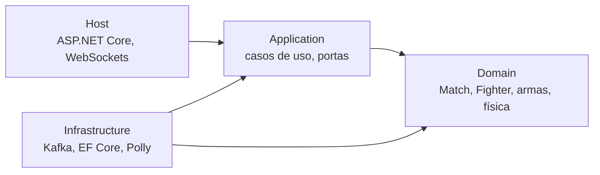
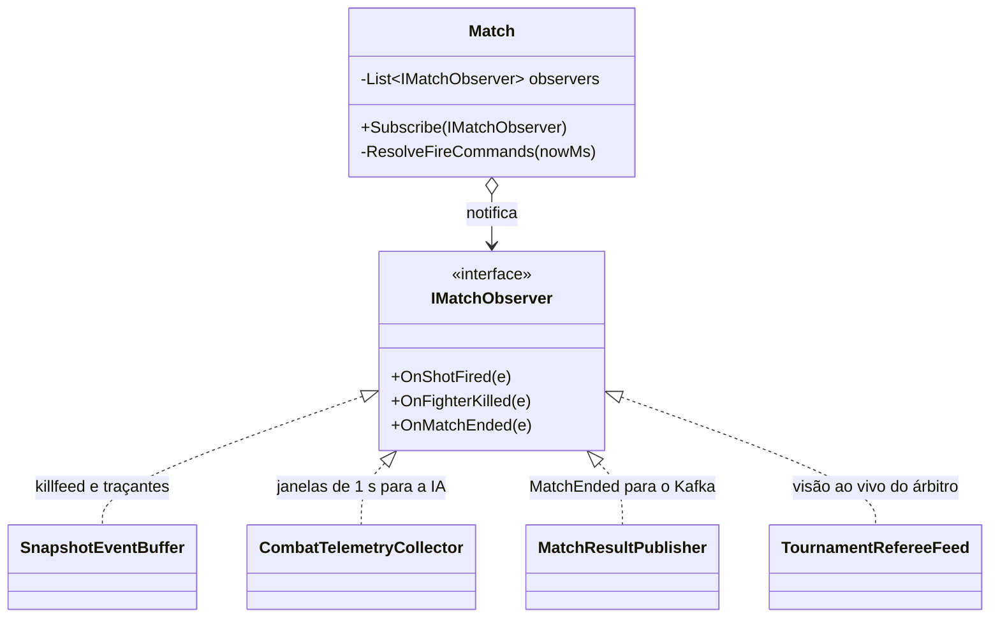

# Princípios SOLID e Catálogo de Padrões GoF

> Os trechos de código são **ilustrativos** (C#), escritos para mostrar a estrutura de cada padrão. Os caminhos indicam onde cada classe ficaria na solução planejada.

## 1. Organização em camadas

Cada contexto segue a mesma regra de dependência (Clean Architecture): dependências apontam sempre para dentro.



| Camada | Pode depender de | Não pode depender de |
|---|---|---|
| Domain | Nada (só a biblioteca padrão do .NET) | Application, Infrastructure, ASP.NET, EF Core, Kafka |
| Application | Domain | Infrastructure, ASP.NET |
| Infrastructure | Application, Domain | Host |
| Host | Todas (é a raiz de composição) | Nada além delas |

Estrutura planejada do Game Server:

```
src/GameServer/
├── Rift.Game.Domain/
│   ├── Arena/            ArenaMap, Aabb, Raycast
│   ├── Combat/           Match, Fighter, Weapon, LagCompensator, FighterMovement
│   ├── Combat/States/    MatchState, WaitingState, WarmupState, InProgressState, EndedState
│   ├── Combat/Weapons/   IWeaponStrategy, RifleStrategy, ShotgunStrategy, RailgunStrategy
│   ├── Combat/Modes/     IGameMode, DeathmatchMode, InstagibMode, MatchCreator (+ subclasses)
│   └── Combat/Events/    IMatchObserver, ShotFired, FighterKilled, MatchEnded
├── Rift.Game.Application/
│   ├── Ports/            IClientConnection, IIntegrationEventPublisher, IClock
│   ├── Rooms/            MatchRoom, MatchRoomRegistry
│   └── Observers/        SnapshotEventBuffer, CombatTelemetryCollector, MatchResultPublisher
├── Rift.Game.Infrastructure/
│   ├── Messaging/        KafkaIntegrationEventPublisher
│   └── Realtime/         WebSocketClientConnection, MessagePackSerializer
└── Rift.Game.Host/       Program.cs, GameLoopService, AllocationGrpcService
```

## 2. Princípios SOLID aplicados

### Dependency Inversion Principle (DIP)

O domínio e a aplicação declaram **portas** (interfaces); a infraestrutura fornece as implementações concretas. O núcleo nunca sabe que Kafka ou WebSocket existem.

```csharp
// Rift.Game.Application/Ports/IIntegrationEventPublisher.cs
public interface IIntegrationEventPublisher
{
    ValueTask PublishAsync<T>(T integrationEvent, CancellationToken ct) where T : IIntegrationEvent;
}

// Rift.Game.Infrastructure/Messaging/KafkaIntegrationEventPublisher.cs
public sealed class KafkaIntegrationEventPublisher : IIntegrationEventPublisher { /* ... */ }

// Rift.Game.Host/Program.cs (raiz de composição)
builder.Services.AddSingleton<IIntegrationEventPublisher, KafkaIntegrationEventPublisher>();
```

Nos testes, `IIntegrationEventPublisher` é substituído por uma implementação em memória: a simulação inteira roda sem broker.

O mesmo vale para o tempo: o domínio recebe `nowMs` como parâmetro, nunca chama `DateTime.Now`. Isso torna cada tick reproduzível em teste.

### Open/Closed Principle (OCP)

`Match` está **fechada para modificação e aberta para extensão**: novas armas implementam `IWeaponStrategy`, novos modos estendem `MatchCreator` e implementam `IGameMode`. Nenhuma linha de `Match` muda (cenário C8, verificado por fitness function na Sprint 4).

### Single Responsibility Principle (SRP)

| Classe | Única razão para mudar |
|---|---|
| `Match` | Regras de orquestração da partida |
| `FighterMovement` | Física de movimento |
| `LagCompensator` | Regra de rebobinamento |
| `SnapshotBuilder` | Formato do que o cliente recebe |
| `MatchResultPublisher` | Contrato do evento de integração |

### Liskov Substitution e Interface Segregation

- Todo `MatchState` respeita o mesmo contrato (`Tick`, `OnEnter`, `AllowsCombat`) e pode substituir outro sem que `Match` precise testar o tipo concreto.
- `IMatchObserver` usa métodos com implementação padrão vazia: cada observador implementa só os eventos que interessam a ele, sem ser forçado a depender dos outros.

## 3. Catálogo de padrões GoF

| Padrão | Categoria | Localização planejada | Problema resolvido |
|---|---|---|---|
| Factory Method | Criacional | `Rift.Game.Domain/Combat/Modes/MatchCreator.cs` | Criar partidas de modos diferentes (Deathmatch, Instagib) sem que o matchmaking conheça as classes concretas de modo e equipamento. |
| Strategy | Comportamental | `Rift.Game.Domain/Combat/Weapons/` | Eliminar `if/switch` por tipo de arma no cálculo de dispersão e dano. |
| State | Comportamental | `Rift.Game.Domain/Combat/States/` | Eliminar condicionais de fase espalhadas por `Match` (pode atirar? pode entrar? quando termina?). |
| Observer | Comportamental | `Rift.Game.Domain/Combat/Events/IMatchObserver.cs` | Desacoplar o motor de resolução de combate de quem reage aos eventos (killfeed, telemetria, publicação do resultado). |
| Adapter | Estrutural | `Rift.Federation.Infrastructure/Acl/` (Sprint 3) | Traduzir o modelo do domínio para o XML da federação legada. |

### 3.1 Strategy: comportamento das armas

```csharp
public interface IWeaponStrategy
{
    WeaponKind Kind { get; }
    int MagazineSize { get; }
    int CooldownMs { get; }
    int ReloadMs { get; }
    IReadOnlyList<Vec3> ShotDirections(Orientation aim, IRandomSource rng);
    int DamageFor(in HitInfo hit);
}

public sealed class ShotgunStrategy : IWeaponStrategy
{
    public WeaponKind Kind => WeaponKind.Shotgun;
    public int MagazineSize => 6;
    public int CooldownMs => 850;
    public int ReloadMs => 2200;

    public IReadOnlyList<Vec3> ShotDirections(Orientation aim, IRandomSource rng)
        => Enumerable.Range(0, 8).Select(_ => aim.Forward.WithSpread(degrees: 4, rng)).ToArray();

    public int DamageFor(in HitInfo hit)
    {
        var falloff = Math.Clamp(1 - (hit.Distance - 10) / 15 * 0.5, 0.5, 1.0);
        var dmg = 11 * falloff;
        return (int)Math.Round(hit.IsHeadshot ? dmg * 2 : dmg);
    }
}

// Em Match: nenhum switch por tipo de arma
foreach (var direction in weapon.Behavior.ShotDirections(command.Aim, _rng))
{
    var hit = _lagCompensator.Resolve(shooter, direction, command.ClientTimeMs);
    if (hit is { } h) ApplyDamage(shooter, h.Target, weapon.Behavior.DamageFor(h), nowMs);
}
```

### 3.2 Factory Method: criação de partidas por modo

```csharp
public abstract class MatchCreator
{
    // O "factory method": subclasses decidem qual modo concreto criar.
    protected abstract IGameMode CreateGameMode(MatchSettings settings);

    public Match CreateMatch(MatchId id, ArenaMap map, MatchSettings settings, IRandomSource rng)
    {
        var mode = CreateGameMode(settings);
        return new Match(id, map, mode, rng);   // Match recebe a abstração
    }
}

public sealed class DeathmatchMatchCreator : MatchCreator
{
    protected override IGameMode CreateGameMode(MatchSettings s) => new DeathmatchMode(s.ScoreLimit ?? 20);
}

public sealed class InstagibMatchCreator : MatchCreator
{
    protected override IGameMode CreateGameMode(MatchSettings s) => new InstagibMode(s.ScoreLimit ?? 15);
}

// Registro na raiz de composição: o serviço de alocação escolhe pelo nome do modo
services.AddKeyedSingleton<MatchCreator, DeathmatchMatchCreator>("deathmatch");
services.AddKeyedSingleton<MatchCreator, InstagibMatchCreator>("instagib");
```

### 3.3 State: ciclo de vida da partida

```csharp
public abstract class MatchState
{
    public abstract MatchPhase Phase { get; }
    public virtual bool AllowsCombat => false;
    public virtual void OnEnter(Match match, long nowMs) { }
    public abstract void Tick(Match match, long nowMs);
}

public sealed class WarmupState : MatchState
{
    private long _endsAt;
    public override MatchPhase Phase => MatchPhase.Warmup;
    public override void OnEnter(Match m, long now) => _endsAt = now + 5_000;

    public override void Tick(Match m, long now)
    {
        if (m.PlayerCount < m.Mode.MinPlayers) m.TransitionTo(new WaitingState(), now);
        else if (now >= _endsAt) m.TransitionTo(new InProgressState(), now);
    }
}

public sealed class InProgressState : MatchState
{
    public override MatchPhase Phase => MatchPhase.InProgress;
    public override bool AllowsCombat => true;
    public override void OnEnter(Match m, long now) => m.ResetScoreboard(now);

    public override void Tick(Match m, long now)
    {
        m.RespawnDeadFighters(now, delayMs: 3_000);
        if (m.Mode.IsFinished(m, now) || m.PlayerCount < m.Mode.MinPlayers)
            m.TransitionTo(new EndedState(), now);
    }
}
```

### 3.4 Observer: eventos da partida, desacoplados do motor de resolução

Este é o entregável do kata *Going... Going... Gone!* ("Observer ou Strategy desacoplado do motor de arremate"). O motor de resolução (`Match.ResolveFireCommands`) só conhece a interface `IMatchObserver`; ele não sabe que existem killfeed, telemetria, IA ou Kafka. Novas reações a eventos (uma conquista, uma estatística, um novo sinal para a IA) entram como novos observadores, sem tocar no motor.



```csharp
public interface IMatchObserver
{
    void OnShotFired(ShotFired e) { }
    void OnFighterDamaged(FighterDamaged e) { }
    void OnFighterKilled(FighterKilled e) { }
    void OnPhaseChanged(MatchPhaseChanged e) { }
    void OnMatchEnded(MatchEnded e) { }
}

// Rift.Game.Application/Observers/CombatTelemetryCollector.cs
public sealed class CombatTelemetryCollector : IMatchObserver
{
    public void OnShotFired(ShotFired e) => _stats[e.ShooterId].Record(e.SnapAngleDeg, e.Hit, e.Headshot, e.Distance);
}

// Rift.Game.Application/Observers/MatchResultPublisher.cs
public sealed class MatchResultPublisher(IIntegrationEventPublisher bus, CombatTelemetryCollector telemetry) : IMatchObserver
{
    public void OnMatchEnded(MatchEnded e) => _outbox.Enqueue(MatchEndedIntegrationEvent.From(e, telemetry.Snapshot()));
}
```

> **Regra importante:** observadores rodam **dentro do tick** (thread da partida), então não podem fazer I/O. Eles apenas enfileiram; o envio real ao broker acontece fora do laço. Isso protege o orçamento de 33 ms por tick.

## 4. Antipadrões evitados

| Antipadrão | Como evitamos |
|---|---|
| Domínio anêmico | Regras ficam em `Match`, `Weapon` e `FighterMovement`, não em "services" genéricos. |
| God class `GameManager` | Responsabilidades divididas entre estado (State), armas (Strategy) e reações (Observer). |
| Domínio dependente de framework | Domain sem referência a ASP.NET, EF Core ou Kafka (verificado por ArchUnitNET). |
| Alocação no laço quente | `Vec3` e `HitInfo` como `readonly struct`; listas reaproveitadas entre ticks. |
