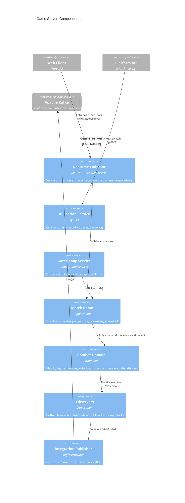
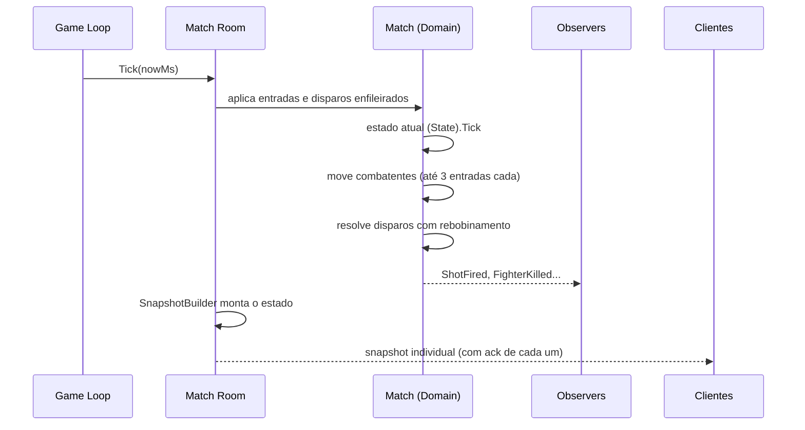

# C4 Nível 3: Componentes do Game Server

O Game Server é o contêiner mais crítico (cenários C1 e C6). Este diagrama mostra seus componentes internos.

## Componentes

| Componente | Camada | Responsabilidade |
|---|---|---|
| Realtime Endpoint | Host | Aceita conexões WebSocket, valida o *join token* emitido pelo matchmaking, desserializa mensagens e as coloca na fila da sala. Nunca altera o domínio diretamente. |
| Allocation Service | Host | Recebe `AllocateMatch(mode, players)` via gRPC, usa o `MatchCreator` do modo e registra a sala. |
| Game Loop Service | Host | Laço de tempo fixo (30 Hz). Mede o próprio atraso e expõe a métrica `tick_duration_ms`. |
| Match Room | Application | Isola a concorrência: comandos chegam de várias threads numa `ConcurrentQueue`, mas só a thread do tick altera o `Match`. Monta e envia snapshots individuais (cada jogador recebe seu próprio ack). |
| Combat Domain | Domain | Todas as regras de jogo. Determinístico, sem I/O. |
| Observers | Application | Reagem aos eventos de domínio sem bloquear o tick. |
| Integration Publisher | Infrastructure | Esvazia a outbox em memória fora do laço e publica no Kafka com retry. |

## Fluxo de um tick

