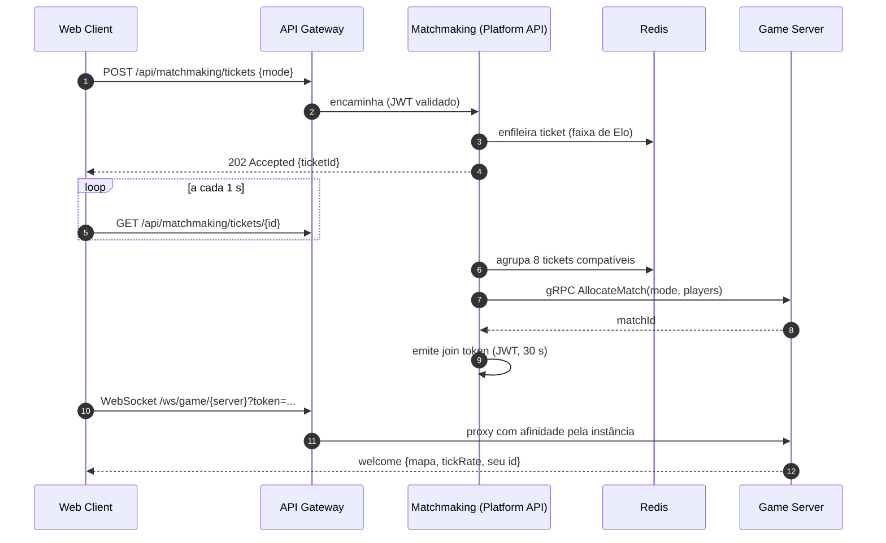
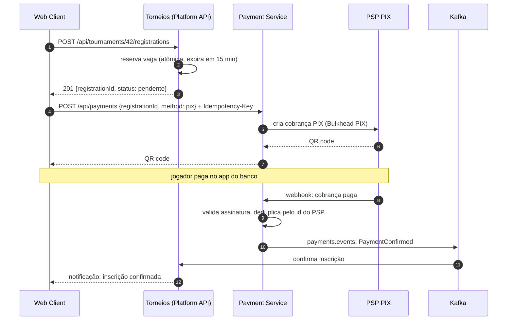

# Canal Bidirecional, Protocolos, Kafka e Netcode

## 1. Mapa de protocolos

| De | Para | Protocolo | Formato | Sincronia | Por quê |
|---|---|---|---|---|---|
| Web Client | Game Server (via Gateway) | **WebSocket** | MessagePack (binário) | **Bidirecional**, contínuo | 30 mensagens/s em cada direção; canal persistente de baixa sobrecarga. |
| Platform API (Torneios) | Game Server | **gRPC bidirectional streaming** | Protobuf | **Bidirecional**, contínuo | Painel do árbitro: o Game Server transmite o estado ao vivo da partida, a plataforma envia comandos (pausar, retomar, desclassificar). |
| Platform API (Matchmaking) | Game Server | gRPC unário | Protobuf | Síncrono | Alocação de partida: chamada interna rápida e tipada. |
| Web Client (árbitro) | Platform API | WebSocket | JSON | Bidirecional | Alertas da IA e controles do árbitro em tempo real. |
| Web Client | Platform API / Payment Service | HTTPS REST | JSON | Síncrono | Login, fila, torneios, pagamentos. |
| Game Server | Plataforma | **Apache Kafka** | Avro (Schema Registry) | Assíncrono | Eventos de combate (fluxo para a IA) e fim de partida. |
| Payment Service | Plataforma | Apache Kafka | Avro | Assíncrono | Pagamento confirmado, recusado, prêmio pago. |
| PSP PIX | Payment Service | Webhook HTTPS | JSON | Assíncrono | Confirmação de PIX pago. |
| Payment Service | PSP PIX / Adquirente | HTTPS | JSON | Síncrono, isolado por Bulkhead | Cobranças, autorizações, pagamento de prêmios. |
| Platform API (Federação) | Federação legada | SOAP | XML | Síncrono, isolado por ACL | Imposto pelo legado. |

## 2. Canal bidirecional com o jogador (WebSocket)

Mensagens com campos curtos, serializadas em MessagePack.

**Cliente para servidor**

| Tipo | Campos | Frequência |
|---|---|---|
| `in` (entrada) | `seq`, `fwd` (-1..1), `right` (-1..1), `jump`, `yaw`, `pitch` | 30 Hz |
| `fire` | `seq`, `yaw`, `pitch` | ao clicar |
| `wpn` | `slot` | ao trocar de arma |
| `rld` | (vazio) | ao recarregar |
| `ping` | `clientTimeMs` | 2 Hz (o servidor mede o RTT usado na ordenação estrita) |

**Servidor para cliente**

| Tipo | Campos |
|---|---|
| `welcome` | `playerId`, `map`, `tickRate`, `mode` |
| `snap` | `tick`, `ack`, `phase`, `phaseEndsInMs`, `players[]` (id, posição, orientação, vida, abates, mortes, arma), `events[]` (tiros, acertos, abates, disparos anulados), `me` (munição, recarga) |
| `pause` | `reason` (enviado quando o árbitro pausa uma partida de torneio) |
| `pong` | `clientTimeMs`, `serverTimeMs` |

## 3. Canal bidirecional entre serviços (gRPC streaming)

```protobuf
service MatchControl {
  // A plataforma abre um stream por partida de torneio:
  // envia comandos e recebe o estado ao vivo, no mesmo canal.
  rpc Control (stream RefereeCommand) returns (stream LiveMatchUpdate);
}

message RefereeCommand {
  string match_id = 1;
  oneof command { Pause pause = 2; Resume resume = 3; Disqualify disqualify = 4; }
}

message LiveMatchUpdate {
  string match_id = 1;
  int64  tick = 2;
  repeated FighterState fighters = 3;   // posição, vida, placar
  repeated KillFeedItem kills = 4;
}
```

O árbitro vê a partida ao vivo e os alertas da IA lado a lado. Se decidir pausar, o comando segue pelo mesmo stream até o Game Server, que coloca a partida no estado `Paused` (um novo `MatchState`, sem alterar `Match`).

## 4. Fluxo de entrada numa partida



## 5. Fluxo de inscrição paga em torneio



**Vagas sem overbooking (cenário C7):** a reserva usa `UPDATE tournaments SET reserved = reserved + 1 WHERE id = @id AND reserved < capacity` (atômico no PostgreSQL). Reserva não paga expira em 15 minutos e devolve a vaga. Só reservas válidas geram cobrança.

## 6. Tópicos Kafka

| Tópico | Produtor | Chave de partição | Partições | Retenção | Consumidores (grupos) |
|---|---|---|---|---|---|
| `combat.windows` | Game Server | `matchId` | 48 | 7 dias | `integrity-stream` (IA em tempo real), `analytics` |
| `match.lifecycle` | Game Server | `matchId` | 12 | 30 dias | `ranking`, `tournaments`, `federation`, `integrity-batch` |
| `payments.events` | Payment Service | `registrationId` | 12 | 90 dias | `tournaments`, `payouts` |
| `integrity.alerts` | Integrity | `matchId` | 12 | 30 dias | `referee-feed`, `payouts` (retenção de prêmio) |
| `*.retry.1m`, `*.retry.10m` | Consumidores | mesma | mesma | 1 dia | o próprio consumidor |
| `*.dlq` | Consumidores | mesma | 3 | 30 dias | painel de operação |

**Por que a chave é `matchId`:** o Kafka garante ordem **dentro de uma partição**. Com `matchId` como chave, todos os eventos de uma partida caem na mesma partição e chegam ao agente de IA **na ordem em que aconteceram**, o que é essencial para análise de janelas deslizantes. Partidas diferentes são processadas em paralelo.

Exemplo de `CombatWindowClosed` (1 por combatente por segundo):

```json
{
  "matchId": "m-20261020-0042", "playerId": "p-91", "windowEndTick": 1830,
  "shots": 6, "hits": 4, "headshots": 3,
  "maxSnapDegBeforeHit": 41.0, "reactionMsMin": 96,
  "nearby": [ { "playerId": "p-17", "distanceM": 6.2, "damageGiven": 0, "damageTaken": 0 } ],
  "rttMs": 38, "tier0Anomalies": 0
}
```

Volume: ~10.000 eventos/s no pico só de janelas (um por jogador por segundo), mais abates e danos: ~25.000 eventos/s, com ~300 bytes cada (~7,5 MB/s). Folgado para um cluster Kafka de 3 brokers.

Consumidores são **idempotentes** pelo `eventId` (entrega "pelo menos uma vez").

## 7. Netcode

O servidor é **autoritativo**: o cliente só envia intenções.

### 7.1 Predição no cliente com reconciliação

O cliente roda a mesma física do servidor para o próprio personagem e mostra o resultado imediatamente. Cada entrada fica guardada até o servidor confirmar (`ack`); ao receber a posição oficial, o cliente reaplica por cima as entradas ainda não confirmadas. Divergências são corrigidas suavemente em ~100 ms.

### 7.2 Interpolação de outros jogadores

Os outros jogadores são desenhados **100 ms no passado**, interpolando entre snapshots. Troca um atraso constante e pequeno por movimento suave mesmo com perda de pacotes.

### 7.3 Compensação de latência e ordenação estrita

Para cada disparo, o servidor calcula `ShotTimeMs = chegada - RTT/2` (ordenação estrita, ver Sprint 2) e rebobina as hitboxes dos alvos para `ShotTimeMs - 100 ms` (atraso de interpolação), limitado a 200 ms no passado.

### 7.4 Defesas no protocolo (tier 0 da integridade)

| Defesa | Regra |
|---|---|
| Limite de entradas | Máximo de 3 entradas por tick por jogador (speedhack). |
| Cadência | Disparo antes do cooldown da arma é descartado e contado como anomalia. |
| Velocidade | Física no servidor; posição do cliente é ignorada. |
| Giro impossível | Variação de mira > 180° entre entradas consecutivas vira anomalia. |
| RTT instável | Variação brusca de RTT (tentativa de manipular a ordenação) vira anomalia. |
| Join token | JWT de 30 s, vinculado a `matchId` e `playerId`, uso único. |
