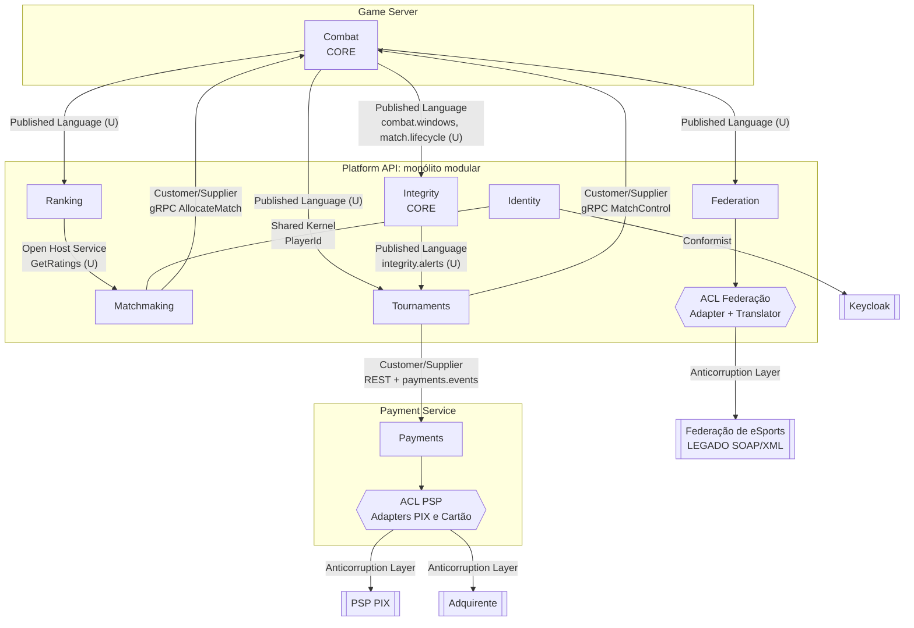
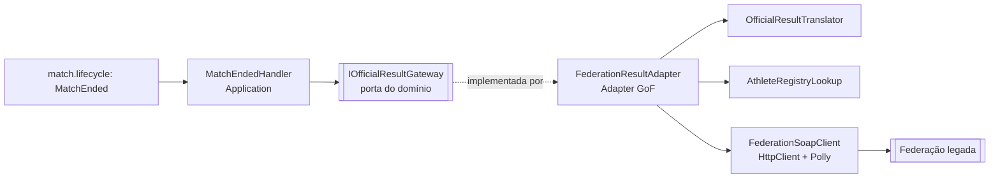

# Mapa de Contexto (DDD) e Camadas Anti-Corrupção

## 1. Contextos delimitados

| Contexto | Subdomínio | Contêiner | Linguagem própria (exemplos) |
|---|---|---|---|
| **Combat** | Core | Game Server | Partida, Combatente, Tick, Disparo, Ordenação, Disparo anulado |
| **Integrity** | Core | Platform API (módulo) | Janela, Suspeita, Conluio, Alerta, Caso, Veredito |
| Tournaments | Supporting | Platform API (módulo) | Torneio, Vaga, Inscrição, Chave, Prêmio, Liberação |
| Matchmaking | Supporting | Platform API (módulo) | Ticket, Faixa de Elo, Alocação |
| Ranking | Supporting | Platform API (módulo) | Rating, Partida Ranqueada, Variação |
| Federation | Supporting | Platform API (módulo) | Relatório Oficial, Envio, Protocolo |
| Payments | Generic | Payment Service | Cobrança, Autorização, Captura, Estorno, Repasse |
| Identity | Generic | Platform API (módulo) + Keycloak | Conta, Convidado, Sessão, Verificação |

A mesma pessoa tem nomes diferentes em cada contexto, e isso é intencional: em Combat ela é um **Combatente**, em Tournaments um **Inscrito**, em Payments um **Pagador** ou **Recebedor**, em Integrity um **Suspeito** (pseudônimo) e na Federação um **Atleta**. Nenhum contexto conhece o modelo do outro.

## 2. Mapa de contexto



| Relação | Tipo | Explicação |
|---|---|---|
| Combat → Integrity, Ranking, Tournaments, Federation | **Published Language** (upstream) | Combat publica eventos versionados no Kafka (schemas Avro no Schema Registry). Não conhece os consumidores. |
| Matchmaking → Combat | **Customer/Supplier** | Alocação de partidas via gRPC. |
| Tournaments → Combat | **Customer/Supplier** | Canal bidirecional do árbitro (gRPC streaming). |
| Tournaments → Payments | **Customer/Supplier** | Torneios pede cobranças e repasses; Payments publica o resultado. |
| Integrity → Tournaments | **Published Language** | Alertas e liberações de integridade; Torneios retém prêmios enquanto houver alerta aberto. |
| Ranking → Matchmaking | **Open Host Service** | Consulta pública de ratings. |
| Identity ↔ demais | **Shared Kernel** (mínimo) | Apenas `PlayerId` (pacote `Rift.SharedKernel`). |
| Identity → Keycloak | **Conformist** | Adotamos o modelo de tokens do Keycloak. |
| Payments → PSP / Adquirente | **Anticorruption Layer** | Cada provedor tem seu modelo (status, códigos de erro); nada disso entra no domínio de Payments. |
| Federation → Legado | **Anticorruption Layer** | Modelo XML hostil isolado num único ponto. |

## 3. Camada Anti-Corrupção da Federação

### 3.1 O problema

A Federação exige um XML com este formato:

```xml
<RESULTADO_PARTIDA>
  <COD_EVENTO>RIFT</COD_EVENTO>
  <DT_PARTIDA>20/10/2026 21:14</DT_PARTIDA>
  <TP_MODALIDADE>3</TP_MODALIDADE>
  <ATLETAS>
    <ATLETA>
      <NR_REGISTRO>000123456</NR_REGISTRO>
      <QT_ABATES>20</QT_ABATES>
      <QT_MORTES>7</QT_MORTES>
      <NR_COLOCACAO>1</NR_COLOCACAO>
      <IN_SUSPEITO>N</IN_SUSPEITO>
    </ATLETA>
  </ATLETAS>
</RESULTADO_PARTIDA>
```

### 3.2 A solução



```csharp
// Rift.Federation.Domain/Ports/IOfficialResultGateway.cs
public interface IOfficialResultGateway
{
    Task<SubmissionReceipt> SubmitAsync(OfficialMatchReport report, CancellationToken ct);
}

// Rift.Federation.Infrastructure/Acl/FederationResultAdapter.cs
internal sealed class FederationResultAdapter(
    FederationSoapClient legacy, OfficialResultTranslator translator,
    AthleteRegistryLookup registry) : IOfficialResultGateway
{
    public async Task<SubmissionReceipt> SubmitAsync(OfficialMatchReport report, CancellationToken ct)
    {
        var athletes = await registry.ResolveAsync(report.Participants, ct);
        ResultadoPartidaXml xml = translator.ToLegacy(report, athletes);
        RetornoXml retorno = await legacy.EnviarResultadoAsync(xml, ct);
        return translator.ToReceipt(retorno);
    }
}
```

## 4. Camada Anti-Corrupção dos provedores de pagamento

O domínio de Payments fala em `PaymentIntent`, `PaymentStatus` (`Pending`, `Confirmed`, `Declined`, `Refunded`) e `Payout`. Cada provedor tem nomes, status e códigos de erro próprios. A porta e os adaptadores:

```csharp
// Rift.Payments.Domain/Ports/IPaymentProvider.cs
public interface IPaymentProvider
{
    PaymentMethod Method { get; }
    Task<ProviderCharge> CreateChargeAsync(PaymentIntent intent, CancellationToken ct);
}

// Rift.Payments.Infrastructure/Acl/Pix/PixProviderAdapter.cs      (Adapter GoF)
// Rift.Payments.Infrastructure/Acl/Card/CardAcquirerAdapter.cs    (Adapter GoF)
// Rift.Payments.Infrastructure/Acl/PaymentProviderFactory.cs      (Factory Method: escolhe o adapter pelo método)
```

| Tradução | Exemplo |
|---|---|
| Status do provedor para o domínio | `"CONCLUIDA"` (PIX) e `"captured"` (cartão) viram `Confirmed` |
| Código de erro para motivo de negócio | `"51"` (cartão sem saldo) vira `DeclineReason.InsufficientFunds` |
| Valor | Centavos inteiros no domínio; formato de cada provedor só no adapter |

Cada adapter roda em seu próprio compartimento de Bulkhead (ver documento de resiliência).

## 5. Consistência entre contextos

| Situação | Estratégia |
|---|---|
| Vários contextos reagem ao mesmo evento | Consistência eventual: cada grupo de consumidores no seu ritmo. |
| Publicação de eventos | Outbox transacional (tabela `outbox` publicada no Kafka por um relay); Game Server usa outbox em memória. |
| Mensagem duplicada | Consumidores idempotentes pelo `eventId`; webhooks deduplicados pelo id do provedor. |
| Inscrição paga, mas vaga expirou | Saga de compensação: `PaymentConfirmed` sem vaga válida dispara estorno automático. |
| Caso de conluio confirmado após o torneio | Prêmio estava retido; Torneios recalcula a classificação e Federation envia `OfficialResultAmended`. |
