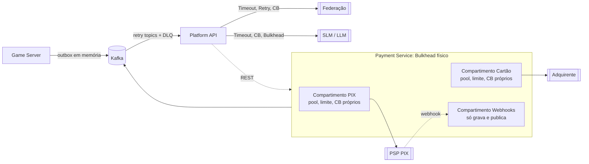
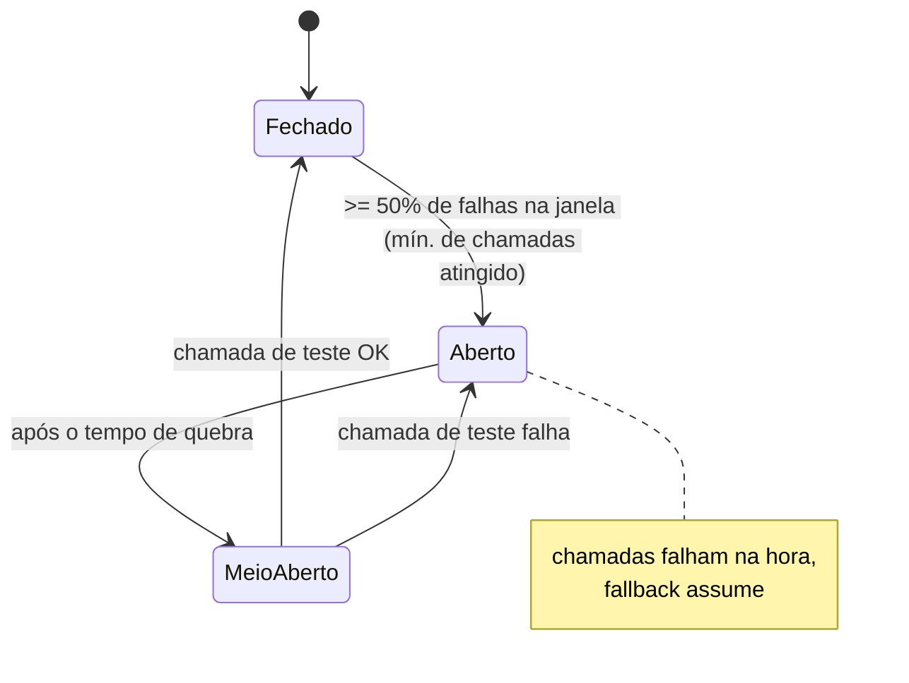
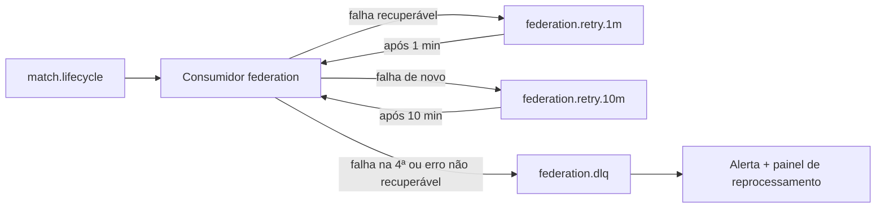

# Resiliência e Estratégia de Bulkhead para Pagamentos PIX/Cartão

Princípio guia: **nenhuma falha fora do Game Server pode afetar uma partida, e nenhuma falha de um provedor de pagamento pode afetar o outro provedor nem o resto do sistema.**

## 1. Visão geral



## 2. Bulkhead do gateway de pagamentos PIX/Cartão

O nome vem das anteparas de um navio: se um compartimento inunda, os outros continuam secos. Aplicamos o isolamento em **três níveis**.

### 2.1 Nível 1: processo (Bulkhead físico)

O Payment Service é um deploy separado (ADR-001). Uma adquirente que trava conexões por 30 s consome threads e sockets **só desse processo**. Game Server e Platform API não compartilham nenhum recurso com ele. Kubernetes impõe limites de CPU e memória ao pod.

### 2.2 Nível 2: compartimentos dentro do Payment Service

| Compartimento | Pool de conexões HTTP | Concorrência máxima | Fila de espera | Timeout | Circuit Breaker |
|---|---|---|---|---|---|
| PIX: criar cobrança | `HttpClient` nomeado `pix` (20 conexões) | 30 | 100 | 3 s | 50% de falhas em 30 s, mín. 10 chamadas, aberto 30 s |
| PIX: pagar prêmio | `pix-payout` (5 conexões) | 5 | 500 (processamento assíncrono) | 10 s | 50% em 60 s, aberto 120 s |
| Cartão: autorizar | `card` (20 conexões) | 30 | 100 | 8 s | 50% em 30 s, mín. 10 chamadas, aberto 30 s |
| Webhooks recebidos | sem chamada externa | 100 | 1.000 | 1 s | não se aplica |

Quando um compartimento está cheio, a requisição seguinte é **rejeitada na hora** (HTTP 503 com `Retry-After`) em vez de esperar e prender uma thread. O webhook só valida a assinatura, grava e publica no Kafka; nunca chama outro serviço, então é sempre rápido.

```csharp
// Rift.Payments.Infrastructure/DependencyInjection.cs (ilustrativo)
services.AddHttpClient<PixProviderAdapter>("pix", c => c.BaseAddress = new(cfg["Pix:Url"]!))
    .ConfigurePrimaryHttpMessageHandler(() => new SocketsHttpHandler { MaxConnectionsPerServer = 20 })
    .AddResilienceHandler("pix-charge", p =>
    {
        p.AddConcurrencyLimiter(permitLimit: 30, queueLimit: 100);   // Bulkhead lógico
        p.AddTimeout(TimeSpan.FromSeconds(3));
        p.AddCircuitBreaker(new HttpCircuitBreakerStrategyOptions
        {
            FailureRatio = 0.5, SamplingDuration = TimeSpan.FromSeconds(30),
            MinimumThroughput = 10, BreakDuration = TimeSpan.FromSeconds(30)
        });
    });

services.AddHttpClient<CardAcquirerAdapter>("card", c => c.BaseAddress = new(cfg["Card:Url"]!))
    .ConfigurePrimaryHttpMessageHandler(() => new SocketsHttpHandler { MaxConnectionsPerServer = 20 })
    .AddResilienceHandler("card-auth", p =>
    {
        p.AddConcurrencyLimiter(permitLimit: 30, queueLimit: 100);
        p.AddTimeout(TimeSpan.FromSeconds(8));
        p.AddCircuitBreaker(new HttpCircuitBreakerStrategyOptions
        {
            FailureRatio = 0.5, SamplingDuration = TimeSpan.FromSeconds(30),
            MinimumThroughput = 10, BreakDuration = TimeSpan.FromSeconds(30)
        });
    });
```

> **Retry em pagamento:** criação de cobrança e autorização de cartão **não** têm retry automático no HTTP, para evitar cobrança duplicada. A segurança vem da `Idempotency-Key` (gerada pelo cliente por inscrição) enviada ao provedor; uma nova tentativa só acontece com a mesma chave.

### 2.3 Nível 3: degradação graciosa na interface

| Situação | O que o jogador vê |
|---|---|
| Circuito do cartão aberto | "Pagamento com cartão indisponível no momento. Pague com PIX." O botão de PIX continua ativo. |
| Circuito do PIX aberto | "PIX indisponível. Pague com cartão ou tente em alguns minutos." Vaga continua reservada por 15 min. |
| Os dois abertos | Inscrição fica "pendente de pagamento" com vaga reservada; notificação quando voltar. |
| Payment Service inteiro fora | Partidas, filas e ranking normais; só a tela de pagamento mostra indisponibilidade. |

O endpoint `GET /api/payments/methods` informa quais métodos estão disponíveis com base no estado dos circuitos, então a interface **nunca trava esperando** um provedor (cenário C3: resposta em < 1 s).

### 2.4 Pagamento de prêmios (payouts)

Prêmios saem por PIX, de forma assíncrona, a partir do tópico `payments.payout-requests`:
1. Só são solicitados após `IntegrityClearance` do torneio (sem alerta aberto) e 48 h de retenção.
2. Consumidor dedicado com concorrência 5 (compartimento próprio).
3. Falhas vão para retry (1 min, 10 min, 1 h) e depois para a DLQ com alerta financeiro.

## 3. Circuit Breaker e Fallback nas demais integrações (Polly)

| Parâmetro | Federação | LLM em nuvem |
|---|---|---|
| Timeout por tentativa | 5 s | 15 s |
| Retry | 3 tentativas, backoff exponencial (1 s, 2 s, 4 s) com jitter | 1 tentativa extra, só 429 e 5xx |
| Circuit Breaker | 50% em 30 s, mín. 10, aberto 60 s | 50% em 60 s, mín. 5, aberto 120 s |
| Bulkhead | 5 simultâneas | 4 simultâneas (SLM: 10) |
| Fallback | Grava relatório na outbox `pending_official_reports` | Usa o veredito do tier anterior |



## 4. Nivelamento de carga, retry e DLQ no Kafka

O Kafka absorve picos (todas as partidas de uma rodada de torneio terminando juntas, abertura de inscrições) e cada grupo de consumidores processa no próprio ritmo.

O Kafka não tem retry com atraso nativo; usamos o padrão de **tópicos de retry**:



Erros **não recuperáveis** (XML rejeitado, atleta sem registro, assinatura de webhook inválida) vão direto para a DLQ.

## 5. Outros padrões

| Padrão | Onde |
|---|---|
| Bulkhead do laço de simulação | Threads dedicadas por grupo de salas, sem `await` de I/O dentro do tick. |
| Outbox transacional | Platform API e Payment Service gravam o evento na mesma transação da mudança de estado; um relay publica no Kafka. |
| Idempotência | `Idempotency-Key` em pagamentos; `eventId` nos consumidores; id do provedor nos webhooks. |
| Saga com compensação | Pagamento confirmado sem vaga válida dispara estorno. |

## 6. Degradação graciosa por dependência

| Dependência fora do ar | Comportamento |
|---|---|
| Adquirente ou PSP | Ver seção 2.3. Jogo intacto. |
| Federação | Jogo normal; relatórios atrasam (outbox). |
| SLM e LLM | Jogo normal; alertas só com regras e estatística, marcados "análise de IA pendente". |
| Kafka | Game Server segura eventos na outbox em memória (até 60 s); alertas em tempo real atrasam. |
| Redis | Matchmaking pausa novas filas; partidas continuam. |
| PostgreSQL da plataforma | Convidados ainda jogam; torneios e ranking indisponíveis. |

## 7. Testes de caos planejados (Sprint 4)

| Teste | Injeção | Critério de sucesso |
|---|---|---|
| Adquirente lenta | Mock do cartão responde em 30 s | Circuito do cartão abre; PIX mantém p95 < 2 s; tick dos Game Servers inalterado |
| PSP fora | Mock do PIX retorna 503 | Interface oferece cartão em < 1 s; nenhuma vaga perdida |
| Webhook duplicado | Mesmo webhook enviado 5 vezes | Uma única confirmação |
| Federação instável | 50% de falhas e 12 s de resposta | Circuito abre em 30 s; 100% dos relatórios entregues em até 5 min após recuperar |
