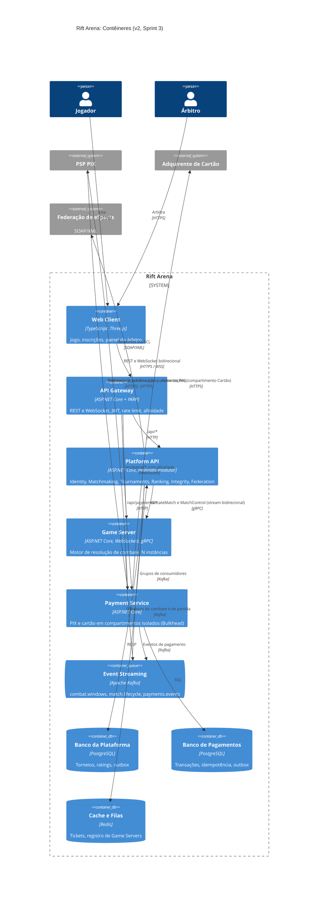

# C4 Nível 2: Diagrama de Contêineres (versão 2)

Evolução da v1 com as decisões do ADR-003 (canal bidirecional e Kafka) e ADR-004 (contextos e ACLs). O agente de IA entra na versão final (Sprint 4).

## Mudanças em relação à v1

| Mudança | Motivo |
|---|---|
| API Gateway (YARP) | Ponto único de entrada; WebSocket com afinidade. Tecnologia formalizada no ADR-005. |
| gRPC unário e **bidirectional streaming** | Alocação de partidas e canal do árbitro (ADR-003). |
| **Apache Kafka** | Fluxo de eventos de combate em tempo real para a IA, ordem por partida, reprocessamento (ADR-003). |
| Compartimentos PIX e Cartão no Payment Service | Estratégia de Bulkhead (documento de resiliência). |
| Redis | Fila de matchmaking e registro de capacidade dos Game Servers. |
| ACLs em Federation e Payments | ADR-004. |
