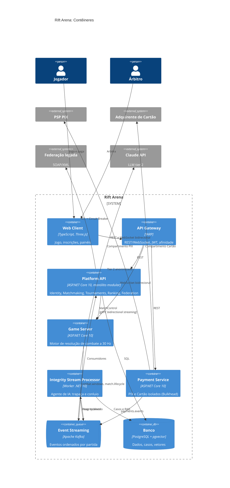
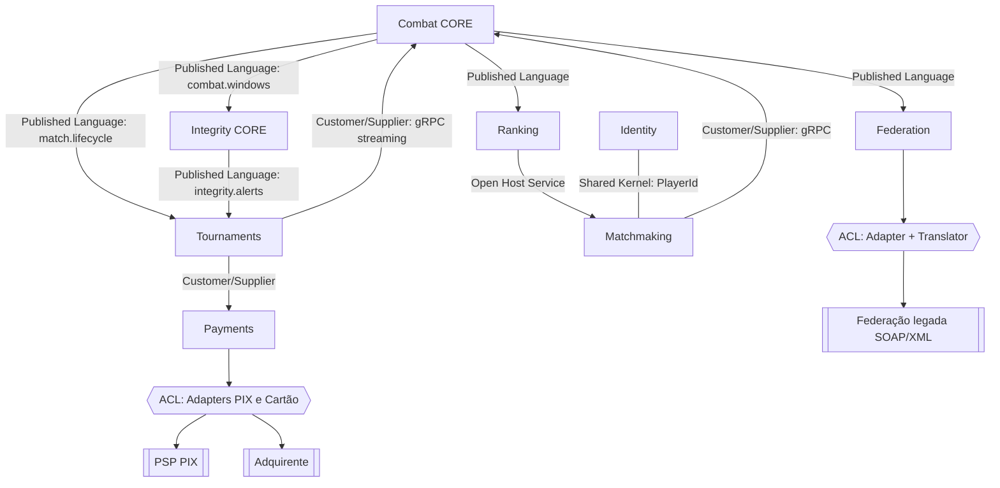

# Projeto Architectural Kata: Rift Arena

**Disciplina:** Arquitetura de Software | **Período:** 6º Período, Engenharia de Software
**Turma:** Quarta-feira | **Sprint / Entrega:** Sprint 4, Final do Projeto por Equipes

## Identificação da Equipe

| Nome do Integrante | Função na Sprint 4 (Liderança / Pesquisador / Executor) | GitHub |
|---|---|---|
| [Nome do Aluno 1 - Líder] | Líder & Arquiteto Principal | @github_user |
| [Nome do Aluno 2] | Pesquisador & Modelagem DDD | @github_user |
| [Nome do Aluno 3] | Pesquisador & Engenheiro de Resiliência & Integração | @github_user |
| [Nome do Aluno 4] | Executor & Especialista em IA-Native & Autonomia | @github_user |
| [Nome do Aluno 5] | Executor & QA & Desenvolvedor de Fitness Functions | @github_user |

---

## 1. Visão Geral do Sistema e Domínio de Negócio

### 1.1. Contexto do Projeto Selecionado

**Architectural Kata:** *Going... Going... Gone!* (Leilões Online em Tempo Real), adaptado para o **Rift Arena**, um FPS competitivo multiplayer no navegador com torneios pagos.

| Going... Going... Gone! | Rift Arena |
|---|---|
| Lances em milissegundos com ordenação estrita | Disparos em milissegundos com ordenação estrita |
| Motor de arremate | Motor de resolução de combate (servidor autoritativo) |
| Agente de IA para fraude e conluio de lances | Agente de IA para trapaça e conluio entre jogadores |
| Gateway de pagamentos PIX/Cartão | Inscrição em torneios e prêmios via PIX/Cartão |

**Desafio Principal de Engenharia:** estruturar a arquitetura de **disparos em milissegundos com ordenação estrita** (até 300.000 entradas por segundo no pico, 1.250 partidas simultâneas, orçamento de 33 ms por tick), integrada a um **Agente de IA para Detecção de Trapaças e Conluios em Tempo Real** sobre um fluxo de ~25.000 eventos de combate por segundo, escalando de 1.000 para 10.000 jogadores em eventos e mantendo o **gateway de pagamentos PIX/Cartão isolado por Bulkhead**, para que nenhuma falha financeira afete as partidas. Detalhes e números: [Visão e Domínio](../sprint-1/docs/01-visao-e-dominio.md).

### 1.2. Resumo da Solução Proposta

O núcleo é o **Game Server**, um processo com estado que mantém cada partida em memória e roda um laço de tempo fixo a 30 Hz. Ele é o **motor de resolução de combate**, equivalente ao motor de arremate do kata: o cliente envia só intenções, e o servidor decide acertos e abates. Dentro de cada tick, os disparos são **ordenados pelo instante em que foram feitos** (chegada menos metade do RTT medido pelo servidor), com desempate pelo número de sequência, e resolvidos um a um sobre posições rebobinadas (compensação de latência até 200 ms); quem foi abatido por um disparo anterior tem os próprios disparos anulados. Os jogadores falam com o Game Server por um **canal bidirecional WebSocket** binário, e o árbitro de torneios controla partidas por **gRPC bidirectional streaming**. A frota escala com Kubernetes + Agones, com instâncias aquecidas para o pico.

Identidade, matchmaking, torneios, ranking e federação vivem na **Platform API**, um monólito modular. **Pagamentos** ficam num serviço próprio, isolado em três níveis de Bulkhead (processo, compartimentos com pools e limites separados para PIX e cartão, e degradação graciosa na interface). Toda a comunicação assíncrona passa pelo **Apache Kafka**, particionado por partida para garantir ordem: o Game Server publica eventos de combate e de fim de partida sem esperar ninguém. A Federação de eSports legada (SOAP/XML) e os provedores de pagamento ficam atrás de Camadas Anti-Corrupção com Adapter.

O **agente de IA** consome o fluxo de combate em janelas deslizantes de 60 s e combina um detector individual (aimbot, reação sobre-humana) com um detector de **conluio** baseado no grafo de interações entre pares (jogadores que não se atacam, foco nas mesmas vítimas, vítimas que não revidam, coocorrência improvável). Regras e estatística filtram, um SLM local decide o óbvio e só os casos ambíguos chegam a um LLM em nuvem, que recebe como contexto os casos parecidos já revisados (RAG com pgvector). O primeiro alerta chega ao árbitro em ~5 s, prêmios dos envolvidos ficam retidos, e a IA nunca pune: humanos decidem.

---

## 2. Atributos de Qualidade e Matriz QAW

Os atributos de qualidade prioritários foram definidos com base nos trade-offs essenciais do sistema. Matriz completa, árvore de utilidade e riscos: [QAW](../sprint-1/docs/02-qaw.md).

| Atributo de Qualidade | Cenário Padronizado (Fonte → Estímulo → Artefato → Ambiente → Resposta) | Medida da Resposta (Métrica Objetivo) |
|---|---|---|
| Desempenho / Latência | 8 jogadores → enviam entradas e disparos a 30 Hz → Game Server → carga normal (50 partidas por instância) → resolve disparos e envia snapshot | p95 do tick < 20 ms; entrada até snapshot p95 < 50 ms; REST p95 < 250 ms |
| Consistência / Ordenação | Dois jogadores → atiram um no outro no mesmo tick → motor de resolução → carga normal → disparo mais cedo vence, o outro é anulado | 100% dos casos determinísticos e reproduzíveis em teste |
| Disponibilidade / Resiliência | Adquirente de cartão → cai ou responde em mais de 10 s → Payment Service → abertura de inscrições → Circuit Breaker abre e a interface oferece PIX | 0 impacto em partidas e no fluxo PIX; interface responde em < 1 s com alternativa |
| Escalabilidade / Elasticidade | Final de torneio → salto de 1.000 para 10.000 jogadores → frota de Game Servers → pico → autoscaling com buffer aquecido | Nova instância em < 45 s; fila p95 < 30 s |
| Segurança / Integridade | Dupla em conluio → evita se atacar numa partida de torneio → agente de IA sobre o Kafka → torneio ao vivo → alerta ao árbitro e prêmio retido | Primeiro alerta em < 10 s; 0 punições automáticas; precisão >= 90% |
| Modificabilidade | Game design → pede nova arma, modo ou reação a eventos → domínio de Combate → desenvolvimento → nova classe sem alterar o motor | Esforço < 1 dia; 0 linhas alteradas em `Match` (fitness function) |

---

## 3. Visão Geral da Arquitetura (Modelo C4)

A arquitetura está documentada conforme as abstrações do Modelo C4:

- 📄 **Nível 1: Diagrama de Contexto:** [c1-contexto.md](../sprint-1/docs/c4/c1-contexto.md)
- 📄 **Nível 2: Diagrama de Contêineres:** [c2-containers-final.md](docs/c4/c2-containers-final.md) (evolução: [v1](../sprint-1/docs/c4/c2-containers-v1.md), [v2](../sprint-3/docs/c4/c2-containers-v2.md))
- 📄 **Nível 3: Diagrama de Componentes:** [Game Server](../sprint-2/docs/c4/c3-componentes-game-server.md) e [Integrity Stream Processor](docs/c4/c2-containers-final.md#c4-nível-3-componentes-do-integrity-stream-processor)

### Visualização do Diagrama de Contêineres (C4 Nível 2)

O diagrama evidencia o **canal bidirecional** (WebSocket e gRPC streaming) e o broker **Apache Kafka**.



---

## 4. Domain-Driven Design (DDD) & Limites de Contexto

Documentação completa em [Modelo de Domínio](../sprint-2/docs/03-modelo-de-dominio.md) e [Mapa de Contexto](../sprint-3/docs/06-mapa-de-contexto-ddd.md).

### 4.1. Classificação dos Subdomínios

- **Core Domain (Domínio Principal):** Resolução de Combate (o "motor de arremate": ordenação estrita de disparos, compensação de latência, regras da partida) e Integridade (detecção de trapaça e conluio em tempo real).
- **Supporting Subdomain (Suporte):** Torneios (vagas, inscrições, prêmios), Matchmaking, Ranking (Elo), Federação (integração com o legado).
- **Generic Subdomain (Genérico):** Pagamentos via PSP PIX e adquirente de cartão terceirizados, Autenticação SSO (Keycloak/OIDC), Event Streaming (Kafka), Observabilidade.

### 4.2. Mapa de Contexto e Camada Anti-Corrupção (ACL)



O sistema integra-se a serviços legados e de terceiros utilizando o padrão **Anti-Corruption Layer (ACL)** com a implementação de adaptadores GoF (**Adapter Pattern**) localizados em `src/Platform/Modules/Federation/Rift.Federation.Infrastructure/Acl/` (Federação: domínio `OfficialMatchReport` traduzido para o XML `<RESULTADO_PARTIDA>`) e `src/Payments/Rift.Payments.Infrastructure/Acl/` (`PixProviderAdapter` e `CardAcquirerAdapter`: status e códigos de cada provedor traduzidos para `PaymentStatus` e `DeclineReason`), isolando a Linguagem Ubíqua do núcleo do sistema. Os tipos externos são `internal` e fitness functions proíbem que vazem. Decisão: [ADR-004](../sprint-3/docs/adr/ADR-004-contextos-e-acl.md).

---

## 5. Padrões de Projeto & Princípios SOLID

Detalhes e código ilustrativo: [SOLID e Padrões GoF](../sprint-2/docs/04-solid-e-padroes-gof.md).

### 5.1. Princípios SOLID Aplicados

- **Dependency Inversion Principle (DIP):** o domínio e a aplicação declaram interfaces de repositórios e serviços (`IPlayerRatingRepository`, `IOfficialResultGateway`, `IPaymentProvider`, `IIntegrationEventPublisher`, `ICheatAnalysisModel`, em `*.Domain/Ports` e `*.Application/Ports`), enquanto a infraestrutura provê a implementação concreta (`EfPlayerRatingRepository`, `FederationResultAdapter`, `PixProviderAdapter`, `KafkaIntegrationEventPublisher`, `ClaudeAnalysisModel`). Tempo (`nowMs`) e aleatoriedade (`IRandomSource`) são injetados, o que torna a resolução de combate determinística em teste.
- **Open/Closed Principle (OCP):** novas armas (`IWeaponStrategy`), modos (`MatchCreator` + `IGameMode`) e reações a eventos (`IMatchObserver`) entram por polimorfismo sem alteração da classe mestre `Match`, verificado por fitness function.
- **SRP, Liskov e Interface Segregation:** física, ordenação, compensação de latência e publicação em classes separadas; estados da partida intercambiáveis; observadores implementam só os eventos que usam.

### 5.2. Catálogo de Padrões GoF Utilizados

| Padrão GoF | Categoria | Localização no Código (planejada) | Problema de Engenharia Resolvido |
|---|---|---|---|
| Factory Method | Criacional | `Rift.Game.Domain/Combat/Modes/MatchCreator.cs`; `Rift.Payments.Infrastructure/Acl/PaymentProviderFactory.cs` | Instanciação dinâmica de partidas por modo e de conectores de pagamento (PIX ou cartão) sem acoplamento a classes concretas. |
| Adapter | Estrutural | `Rift.Federation.Infrastructure/Acl/FederationResultAdapter.cs`; `Rift.Payments.Infrastructure/Acl/{Pix,Card}/` | Tradução de payloads XML/SOAP do legado e dos modelos dos provedores de pagamento para os tipos do domínio. |
| Strategy | Comportamental | `Rift.Game.Domain/Combat/Weapons/` (`RifleStrategy`, `ShotgunStrategy`, `RailgunStrategy`) | Eliminação de `if/switch` por tipo de arma no motor de resolução (dispersão, dano, queda de dano). |
| Observer | Comportamental | `Rift.Game.Domain/Combat/Events/IMatchObserver.cs` | **Desacoplamento do motor de resolução** (equivalente ao motor de arremate): killfeed, telemetria para a IA, feed do árbitro e publicação no Kafka reagem aos eventos sem que o motor os conheça. |
| State | Comportamental | `Rift.Game.Domain/Combat/States/` (`Waiting`, `Warmup`, `InProgress`, `Paused`, `Ended`) | Ciclo de vida da partida, incluindo a pausa do árbitro, sem condicionais de fase no agregado. |
| Chain of Responsibility | Comportamental | `Rift.Integrity.Application/Analysis/TieredCheatAnalyzer.cs` | Encadear os tiers de IA (estatística, SLM, LLM), cada um decidindo ou repassando ao próximo. |

---

## 6. Resiliência, Integração e IA-Native

Detalhes: [Canal Bidirecional, Kafka e Netcode](../sprint-3/docs/05-protocolos-e-netcode.md), [Resiliência e Bulkhead](../sprint-3/docs/07-resiliencia.md) e [Agente de IA](docs/08-ia-anti-cheat.md).

### 6.1. Padrões de Resiliência Aplicados

- **Bulkhead do gateway de pagamentos PIX/Cartão:** três níveis de isolamento. (1) **Processo:** Payment Service em deploy próprio, sem recurso compartilhado com o jogo. (2) **Compartimentos:** pools de conexão, limitadores de concorrência (30 simultâneas, fila de 100) e Circuit Breakers separados para PIX cobrança, PIX prêmio, cartão e webhooks; compartimento cheio rejeita na hora em vez de prender threads. (3) **Interface:** `GET /api/payments/methods` reflete o estado dos circuitos e oferece o método disponível, sem travar a UI.
- **Circuit Breaker & Fallback:** implementado via **Polly v8** nas chamadas HTTP síncronas (provedores de pagamento, Federação, LLM) para evitar *thread starvation*. Fallbacks: outro método de pagamento, outbox de relatórios pendentes, veredito do tier anterior da IA. Pagamentos não têm retry automático; a segurança vem da `Idempotency-Key`.
- **Nivelamento de Carga (Load Leveling):** o Kafka absorve picos (fim de rodada de torneio, abertura de inscrições); cada consumidor tem tópicos de retry (1 min, 10 min) e uma **Dead Letter Queue (DLQ)** atrelada, com alerta e reprocessamento.
- **Outbox transacional, consumidores idempotentes e saga de compensação** (pagamento confirmado sem vaga válida gera estorno).

### 6.2. Componente de Inteligência Artificial Generativa

- **Arquitetura AI-Native:** agente de **detecção de trapaças e conluios em tempo real** sobre o Kafka. O Integrity Stream Processor mantém janelas deslizantes de 60 s por jogador e por par; um detector individual (12 features) e um detector de conluio (grafo de interações: não agressão, foco compartilhado, reciprocidade de abates, coocorrência histórica) alimentam um **Model Tiering** em quatro níveis: regras no Game Server, score estatístico, SLM local (Ollama) e LLM em nuvem (Claude Opus 5.5, effort baixo). O tier 2 usa **RAG** com os 5 casos revisados mais parecidos (pgvector). Primeiro alerta ao árbitro em ~5 s; custo estimado de ~US$ 25/h no pico.
- **Guardrails & Segurança:** saídas estruturadas validadas via **JSON Schema** e revalidadas pelo `VerdictValidator` (cada evidência deve citar uma métrica presente na entrada); **higienização prévia de PII** (pseudônimos por HMAC, nenhum apelido, IP, chat ou dado de pagamento enviado), o que também neutraliza prompt injection; evidência acumulada antes de abrir caso de conluio; orçamento diário de tokens; Circuit Breaker; auditoria; avaliação contínua com **replay do Kafka** bloqueando deploy abaixo de 90% de precisão; e **humano no circuito**: a IA só alerta, abre casos e retém prêmios. Decisão: [ADR-006](docs/adr/ADR-006-ia-e-guardrails.md).

---

## 7. Registros de Decisões Arquiteturais (ADRs)

Todas as decisões estratégicas e seus trade-offs estão registrados nas pastas `docs/adr/` de cada sprint:

| ADR | Título da Decisão Arquitetural | Status | Data |
|---|---|---|---|
| [ADR-001](../sprint-1/docs/adr/ADR-001-estilo-arquitetural.md) | Adoção do Estilo Arquitetural (Monólito Modular vs. Microsserviços) | Aprovado | 2026-09-10 |
| [ADR-002](../sprint-2/docs/adr/ADR-002-dip-e-padroes-gof.md) | Estratégia de Desacoplamento de Código com DIP e Padrões GoF | Aprovado | 2026-10-05 |
| [ADR-003](../sprint-3/docs/adr/ADR-003-protocolos-de-integracao.md) | Mensageria Assíncrona e Protocolos de Integração (WebSocket, gRPC, REST e Kafka) | Aprovado | 2026-10-20 |
| [ADR-004](../sprint-3/docs/adr/ADR-004-contextos-e-acl.md) | Mapeamento de Contextos Delimitados e Camada Anti-Corrupção | Aprovado | 2026-10-28 |
| [ADR-005](docs/adr/ADR-005-stack-tecnologica.md) | Seleção de Frameworks, Banco Vetorial e Stack do API Gateway | Aprovado | 2026-11-05 |
| [ADR-006](docs/adr/ADR-006-ia-e-guardrails.md) | Integração de Componentes Probabilísticos e Guardrails de IA | Aprovado | 2026-11-15 |

Resumo das decisões:

| ADR | Escolha | Principal alternativa descartada |
|---|---|---|
| 001 | Monólito modular + Game Server + Payment Service | Microsserviços completos (custo operacional para 5 pessoas) |
| 002 | Clean Architecture + Strategy, State, Factory Method, Observer desacoplado do motor | Classe central com condicionais; ECS |
| 003 | WebSocket/MessagePack, gRPC streaming, REST, **Kafka** particionado por partida | RabbitMQ (sem ordem por partida nem replay para a IA) |
| 004 | Oito contextos, ACLs com Adapter para legado e pagamentos | Conformist (modelos externos espalhados) |
| 005 | .NET 10, Three.js, YARP, Kafka KRaft, pgvector, Agones | Ocelot (WebSocket limitado), Qdrant (escala não justifica) |
| 006 | Stream processing + tiering + RAG + humano no circuito | Análise só pós-partida (alerta tarde demais); LLM para tudo |

---

## 8. Testes & Fitness Functions (Governança Automatizada)

Detalhes, código e métricas: [Fitness Functions](docs/09-fitness-functions.md).

### 8.1. Execução das Fitness Functions (ArchUnit)

Para garantir que as regras de dependência entre camadas não sejam violadas no código, os testes de arquitetura automatizados (**ArchUnitNET + xUnit**) rodam em todo push e quebram o build em caso de violação:

- **Regra Validada 1:** a camada de Domínio não possui referência direta para a camada de Infraestrutura.
- **Regra Validada 2:** todas as classes de repositório implementam uma interface abstrata correspondente.
- **Regra Validada 3:** o Domínio não depende de frameworks (ASP.NET Core, EF Core, Confluent.Kafka, Polly).
- **Regra Validada 4:** tipos do modelo legado da Federação não são referenciados fora da ACL.
- **Regra Validada 5:** módulos não acessam o interior uns dos outros.
- **Regra Validada 6:** `Match` depende apenas das abstrações de arma e modo (OCP).
- **Regra Validada 7:** modelos de PSP e adquirente ficam restritos à ACL de Payments.
- **Regra Validada 8:** o motor de resolução não depende de nenhum observador concreto (Observer desacoplado, entregável do kata).

```csharp
[Fact]
public void Domain_nao_depende_de_infraestrutura() =>
    Types().That().ResideInNamespace("Rift.*.Domain", useRegularExpressions: true)
        .Should().NotDependOnAny(Types().That()
            .ResideInNamespace("Rift.*.Infrastructure", useRegularExpressions: true))
        .Because("ADR-002: dependências apontam para dentro")
        .Check(Arch);
```

### 8.2. Métricas e fitness functions de desempenho e comportamento

| Fitness function | Ferramenta | Limite |
|---|---|---|
| Distância da sequência principal (D) por projeto | Teste próprio (reflexão) | D <= 0,5 (exceto projetos Domain, justificado) |
| Ordenação estrita | Testes de propriedade com trocas de tiro geradas | Resultado nunca depende da ordem de chegada |
| REST p95 | k6 | < 250 ms |
| Tick p99 com 50 partidas | Enxame de 200 bots | < 33 ms |
| Bulkhead de pagamentos | Mock da adquirente com 30 s de resposta | PIX p95 < 2 s; tick inalterado |
| Latência do alerta de IA | Replay de partidas com conluio simulado | Primeiro alerta < 10 s |
| Precisão do agente de IA | Replay do Kafka contra casos revisados | >= 90% |

---

## 9. Evolução por Sprint

| Sprint | Entregáveis | Pasta |
|---|---|---|
| 1 | Adaptação do kata, visão, subdomínios, QAW, C4 L1 e L2 v1, ADR-001 | [sprint-1](../sprint-1/README.md) |
| 2 | Modelo de domínio, ordenação estrita, SOLID, Observer/Strategy desacoplados, C4 L3, ADR-002 | [sprint-2](../sprint-2/README.md) |
| 3 | Canal bidirecional, Kafka, mapa de contexto + ACLs, Bulkhead PIX/Cartão, C4 L2 v2, ADR-003 e 004 | [sprint-3](../sprint-3/README.md) |
| 4 | Agente de IA de trapaça e conluio, fitness functions, C4 final, ADR-005 e 006, este documento | esta pasta |

## 10. Limitações e Próximos Passos

- **Transporte:** WebSocket roda sobre TCP e sofre com perda de pacotes; WebRTC DataChannel (UDP) é a evolução natural.
- **Física duplicada** em C# e TypeScript; alternativa futura: compilar a física para WebAssembly e usar o mesmo código nos dois lados.
- **Instância de Game Server que cai perde as partidas dela:** aceito para partidas casuais; em torneio, o árbitro refaz a partida. Snapshots periódicos no Redis seriam a mitigação.
- **Integridade:** com casos revisados suficientes, treinar um classificador próprio (incluindo uma rede de grafos para conluio) para substituir parte do tier 1.
- **Pagamentos:** conciliação diária automática com extratos do PSP e da adquirente.
