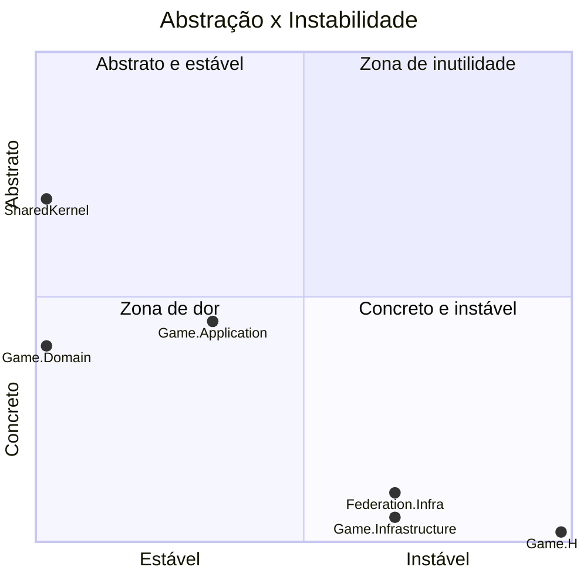

# Testes e Fitness Functions (Governança Automatizada)

Fitness functions são verificações automatizadas que garantem que a arquitetura decidida continua sendo a arquitetura implementada. Elas rodam no pipeline de CI e **quebram o build** quando violadas.

## 1. Pipeline de CI planejado

| Etapa | Ferramenta | Gatilho | Quebra o build se |
|---|---|---|---|
| Testes unitários do domínio | xUnit | Todo push | Algum teste falha |
| Fitness functions estruturais | ArchUnitNET | Todo push | Regra de dependência violada |
| Métricas de instabilidade e abstração | Teste próprio (reflexão) | Todo push | Distância da sequência principal (D) > 0,5 em algum projeto |
| Desempenho da API | k6 | Pull request para `main` | p95 > 250 ms |
| Desempenho do tick | Enxame de bots (200 clientes simulados) | Diário | p99 do tick > 33 ms |
| Caos da Federação | Mock com 50% de falhas | Diário | Tick afetado ou relatório perdido |
| Caos de pagamentos (Bulkhead) | Mock da adquirente com 30 s de resposta | Diário | p95 do PIX > 2 s ou tick afetado |
| Ordenação estrita | Testes com trocas de tiro geradas (propriedades) | Todo push | Resultado depende da ordem de chegada |
| Latência do alerta de IA | Replay de partidas com conluio simulado | Diário | Primeiro alerta > 10 s |
| Avaliação da IA | Conjunto rotulado | Mudança de prompt ou modelo | Precisão < 90% |

## 2. Fitness functions estruturais (ArchUnitNET)

Código ilustrativo do projeto `tests/Rift.ArchitectureTests`:

```csharp
using ArchUnitNET.Domain;
using ArchUnitNET.Loader;
using ArchUnitNET.xUnit;
using static ArchUnitNET.Fluent.ArchRuleDefinition;

public class LayerRules
{
    private static readonly Architecture Arch = new ArchLoader().LoadAssemblies(
        typeof(Rift.Game.Domain.Combat.Match).Assembly,
        typeof(Rift.Game.Application.Rooms.MatchRoom).Assembly,
        typeof(Rift.Game.Infrastructure.Messaging.KafkaIntegrationEventPublisher).Assembly,
        typeof(Rift.Federation.Infrastructure.DependencyInjection).Assembly,
        typeof(Rift.Ranking.Domain.PlayerRating).Assembly,
        typeof(Rift.Payments.Infrastructure.DependencyInjection).Assembly).Build();

    // Regra 1: o Domínio não referencia a Infraestrutura
    [Fact]
    public void Domain_nao_depende_de_infraestrutura() =>
        Types().That().ResideInNamespace("Rift.*.Domain", useRegularExpressions: true)
            .Should().NotDependOnAny(Types().That()
                .ResideInNamespace("Rift.*.Infrastructure", useRegularExpressions: true))
            .Because("ADR-002: dependências apontam para dentro")
            .Check(Arch);

    // Regra 2: todo repositório implementa uma interface abstrata
    [Fact]
    public void Repositorios_implementam_interface() =>
        Classes().That().HaveNameEndingWith("Repository")
            .Should().ImplementInterface("I.*Repository", useRegularExpressions: true)
            .Check(Arch);

    // Regra 3: o Domínio não depende de frameworks
    [Fact]
    public void Domain_livre_de_frameworks() =>
        Types().That().ResideInNamespace("Rift.*.Domain", useRegularExpressions: true)
            .Should().NotDependOnAny(Types().That()
                .ResideInNamespace("(Microsoft.AspNetCore|Microsoft.EntityFrameworkCore|Confluent.Kafka|Polly).*",
                                   useRegularExpressions: true))
            .Check(Arch);

    // Regra 4: o modelo XML do legado não vaza para fora da ACL
    [Fact]
    public void Tipos_do_legado_ficam_na_acl() =>
        Types().That().DoNotResideInNamespace("Rift.Federation.Infrastructure.Acl")
            .Should().NotDependOnAny(Types().That()
                .ResideInNamespace("Rift.Federation.Infrastructure.Acl.Legacy"))
            .Because("ADR-004: Camada Anti-Corrupção")
            .Check(Arch);

    // Regra 5: um módulo não acessa o interior de outro
    [Fact]
    public void Ranking_nao_conhece_integrity() =>
        Types().That().ResideInNamespace("Rift.Ranking.*", useRegularExpressions: true)
            .Should().NotDependOnAny(Types().That()
                .ResideInNamespace("Rift.Integrity.*", useRegularExpressions: true))
            .Because("ADR-001: módulos se comunicam só por eventos e contratos públicos")
            .Check(Arch);

    // Regra 6: Match fechada para modificação (OCP): não conhece armas nem modos concretos
    [Fact]
    public void Match_depende_so_de_abstracoes_de_arma_e_modo() =>
        Classes().That().HaveFullName("Rift.Game.Domain.Combat.Match")
            .Should().NotDependOnAny(Classes().That()
                .HaveNameEndingWith("Strategy").Or().HaveNameEndingWith("Mode"))
            .Because("cenário C8: nova arma, modo ou reação sem alterar Match")
            .Check(Arch);

    // Regra 7: modelos dos provedores de pagamento ficam na ACL de Payments
    [Fact]
    public void Tipos_dos_provedores_de_pagamento_ficam_na_acl() =>
        Types().That().DoNotResideInNamespace("Rift.Payments.Infrastructure.Acl.*", useRegularExpressions: true)
            .Should().NotDependOnAny(Types().That()
                .ResideInNamespace("Rift.Payments.Infrastructure.Acl.(Pix|Card).Contracts", useRegularExpressions: true))
            .Because("ADR-004: PSP e adquirente isolados por ACL")
            .Check(Arch);

    // Regra 8: o motor de resolução não chama observadores concretos nem infraestrutura de mensageria
    [Fact]
    public void Motor_de_resolucao_desacoplado_dos_observadores() =>
        Classes().That().HaveFullName("Rift.Game.Domain.Combat.Match")
            .Should().NotDependOnAny(Classes().That().ImplementInterface("Rift.Game.Domain.Combat.Events.IMatchObserver"))
            .Because("entregável do kata: Observer desacoplado do motor de arremate (resolução)")
            .Check(Arch);
}
```

| # | Regra | Origem | Cenário |
|---|---|---|---|
| 1 | Domínio não referencia Infraestrutura | ADR-002 | C8 |
| 2 | Repositórios implementam interface | ADR-002 (DIP) | C8 |
| 3 | Domínio livre de frameworks | ADR-002 | C1, C8 |
| 4 | Tipos do legado restritos à ACL | ADR-004 | C8 |
| 5 | Módulos isolados entre si | ADR-001 | C8 |
| 6 | `Match` depende só de abstrações de arma e modo | ADR-002 (OCP) | C8 |
| 7 | Modelos de PSP e adquirente restritos à ACL de Payments | ADR-004 | C3 |
| 8 | Motor de resolução desacoplado dos observadores concretos | ADR-002 (Observer) | C8 |

## 3. Métricas quantitativas: Instabilidade (I) e Abstração (A)

Calculadas por projeto (assembly) a cada build:

- **Ce** (acoplamento eferente): quantos outros projetos este projeto usa.
- **Ca** (acoplamento aferente): quantos projetos usam este.
- **I = Ce / (Ca + Ce)**: 0 = estável (muitos dependem dele), 1 = instável.
- **A = tipos abstratos / total de tipos**.
- **D = |A + I - 1|**: distância da sequência principal (ideal perto de 0).

Valores-alvo projetados para o Game Server e módulos principais:

| Projeto | Ca | Ce | I | A | D | Leitura |
|---|---|---|---|---|---|---|
| Rift.Game.Domain | 3 | 0 | 0,00 | 0,40 | 0,60 | Estável; abstração moderada (núcleo rico em regras concretas) |
| Rift.Game.Application | 2 | 1 | 0,33 | 0,45 | 0,22 | Próximo da sequência principal |
| Rift.Game.Infrastructure | 1 | 2 | 0,67 | 0,05 | 0,28 | Concreto e instável, como esperado |
| Rift.Game.Host | 0 | 3 | 1,00 | 0,00 | 0,00 | Raiz de composição, totalmente instável |
| Rift.SharedKernel | 6 | 0 | 0,00 | 0,70 | 0,30 | Estável e abstrato |
| Rift.Federation.Infrastructure | 1 | 2 | 0,67 | 0,10 | 0,23 | Concreto (ACL) |

> **Observação honesta:** o Domain tende a ficar na "zona de dor" (estável e concreto, D = 0,60), porque regras de jogo são classes concretas por natureza. Aceitamos isso para o Domain, pois a mudança nele é controlada pelos padrões Strategy e State. O limite D > 0,5 no CI vale para todos os projetos **exceto** os de Domain, com essa exceção registrada aqui.



## 4. Fitness functions de desempenho

### API REST (k6)

```javascript
export const options = {
  stages: [ { duration: '2m', target: 500 }, { duration: '5m', target: 2000 } ],
  thresholds: {
    http_req_duration: ['p(95)<250'],      // cenário C2
    http_req_failed:   ['rate<0.01'],
  },
};
```

### Game Server (enxame de bots)

Um script Node.js abre 200 conexões WebSocket (25 partidas de 8 bots) contra uma instância e mede, pelo endpoint de métricas do servidor:

| Métrica | Limite | Cenário |
|---|---|---|
| `tick_duration_ms` p99 | < 33 ms | C1 |
| `tick_duration_ms` p95 | < 20 ms | C1 |
| Entrada até snapshot p95 | < 50 ms | C1 |
| Uso de CPU com 50 partidas | < 80% de 2 vCPU | Dimensionamento |

Os mesmos bots têm um modo "aimbot" (mira perfeita com reação de 80 ms) e um modo "dupla em conluio" (dois bots que nunca se atacam e focam os mesmos alvos), que alimentam o conjunto de avaliação da IA (G10).

## 5. Testes do domínio (exemplos)

| Teste | Verifica |
|---|---|
| `Rifle_nao_dispara_antes_do_cooldown` | Invariante I4 |
| `Disparo_atravessando_parede_nao_acerta` | Raycast contra a arena |
| `Rebobinamento_acerta_alvo_na_posicao_vista` | Compensação de latência (C6) |
| `Rebobinamento_maximo_de_200ms` | Invariante I6 |
| `Mais_de_3_entradas_por_tick_sao_descartadas` | Invariante I5 |
| `Partida_vai_para_encerrada_ao_atingir_limite` | State + IGameMode |
| `Dano_ignorado_no_aquecimento` | Invariante I2 |
| `Simulacao_com_mesma_semente_e_deterministica` | DIP de tempo e aleatoriedade |
| `Disparo_mais_cedo_vence_mesmo_chegando_depois` | Ordenação estrita (I9, cenário C2) |
| `Abatido_no_tick_tem_disparos_seguintes_anulados` | Sem abate póstumo (I10) |
