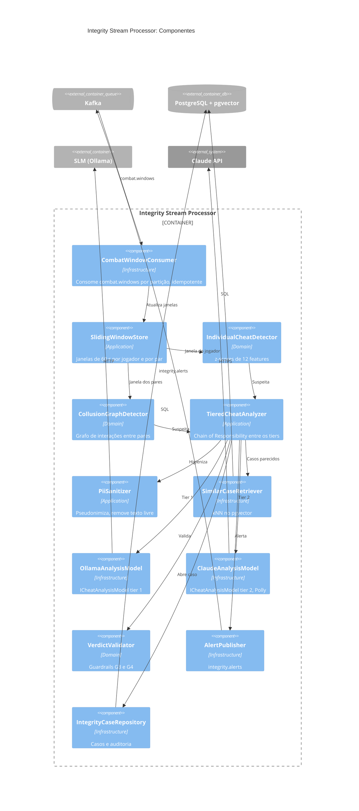

# C4 Nível 2: Diagrama de Contêineres (versão final)

Evidencia os dois entregáveis estruturais do kata *Going... Going... Gone!*: o **canal bidirecional** (WebSocket com os jogadores e gRPC streaming entre serviços) e o broker **Apache Kafka**.

```mermaid
C4Container
    title Rift Arena: Contêineres (final, Sprint 4)

    Person(player, "Jogador")
    Person(ref, "Árbitro")
    Person(mod, "Moderador")

    System_Boundary(rift, "Rift Arena") {
        Container(web, "Web Client", "TypeScript, Three.js, Vite", "Jogo, inscrições, painéis de árbitro e moderação")
        Container(gw, "API Gateway", "ASP.NET Core + YARP", "REST e WebSocket, JWT, rate limit, afinidade")
        Container(platform, "Platform API", "ASP.NET Core 10, monólito modular", "Identity, Matchmaking, Tournaments, Ranking, Federation")
        Container(integrity, "Integrity Stream Processor", "ASP.NET Core 10 Worker", "Agente de IA: janelas deslizantes, trapaça e conluio")
        Container(game, "Game Server", "ASP.NET Core 10, WebSockets, gRPC", "Motor de resolução de combate a 30 Hz, frota escalável")
        Container(pay, "Payment Service", "ASP.NET Core 10", "PIX e cartão em compartimentos isolados (Bulkhead)")
        Container(slm, "SLM Local", "Ollama", "Tier 1 da IA")
        ContainerQueue(kafka, "Event Streaming", "Apache Kafka (KRaft) + Schema Registry", "combat.windows, match.lifecycle, payments.events, integrity.alerts")
        ContainerDb(db, "Banco da Plataforma", "PostgreSQL + pgvector", "Torneios, ratings, casos, vetores de casos revisados, outbox")
        ContainerDb(paydb, "Banco de Pagamentos", "PostgreSQL", "Transações, idempotência, outbox")
        ContainerDb(redis, "Cache e Filas", "Redis", "Tickets, registro de servidores, coocorrência")
    }

    System_Ext(pix, "PSP PIX")
    System_Ext(card, "Adquirente de Cartão")
    System_Ext(fed, "Federação de eSports", "SOAP/XML legado")
    System_Ext(llm, "Claude API", "LLM tier 2")
    System_Ext(idp, "Keycloak / OIDC")

    Rel(player, web, "Joga e paga", "HTTPS")
    Rel(ref, web, "Arbitra ao vivo", "HTTPS")
    Rel(mod, web, "Revisa casos", "HTTPS")
    Rel(web, gw, "REST e WebSocket bidirecional", "HTTPS / WSS")
    Rel(gw, game, "/ws/game/* com afinidade", "WebSocket")
    Rel(gw, platform, "/api/* e /ws/referee", "HTTP / WebSocket")
    Rel(gw, pay, "/api/payments/*", "HTTP")
    Rel(platform, game, "AllocateMatch e MatchControl (stream bidirecional)", "gRPC")
    Rel(game, kafka, "combat.windows, match.lifecycle", "Kafka")
    Rel(kafka, integrity, "Fluxo ordenado por partida", "Kafka")
    Rel(integrity, kafka, "integrity.alerts", "Kafka")
    Rel(kafka, platform, "Consumidores por módulo", "Kafka")
    Rel(pay, kafka, "payments.events", "Kafka")
    Rel(integrity, slm, "Tier 1", "HTTP/JSON")
    Rel(integrity, llm, "Tier 2 anonimizado", "HTTPS")
    Rel(integrity, db, "Casos e RAG", "SQL")
    Rel(platform, db, "SQL")
    Rel(platform, redis, "RESP")
    Rel(pay, paydb, "SQL")
    Rel(pay, pix, "Compartimento PIX", "HTTPS")
    Rel(pay, card, "Compartimento Cartão", "HTTPS")
    Rel(platform, fed, "ACL + Circuit Breaker", "SOAP/XML")
    Rel(platform, idp, "Valida tokens", "OIDC")
```

> **Mudança em relação à v2:** o módulo Integrity foi extraído da Platform API para um worker próprio, como o ADR-001 previa. Motivo: o processamento de fluxo mantém estado em memória por partição Kafka e consome CPU de forma contínua, perfil diferente das requisições REST da plataforma. O código continua organizado como módulo (Domain, Application, Infrastructure).

## Contêineres

| Contêiner | Tecnologia | Responsabilidade | Escala |
|---|---|---|---|
| Web Client | TypeScript, Three.js | Jogo e painéis | CDN |
| API Gateway | YARP | Ponto único de entrada | 2+ réplicas |
| Platform API | ASP.NET Core 10 | Cinco módulos de negócio | HPA por CPU, 2 a 10 réplicas |
| Integrity Stream Processor | Worker .NET 10 | Agente de IA em tempo real | Até 48 réplicas (uma por partição de `combat.windows`) |
| Game Server | ASP.NET Core 10 | Partidas em memória | Agones Fleet Autoscaler, 2 a 30 instâncias, buffer de 3 |
| Payment Service | ASP.NET Core 10 | Pagamentos isolados | 2 a 4 réplicas |
| SLM Local | Ollama | Tier 1 | 1 a 3 réplicas com GPU |
| Kafka | KRaft + Schema Registry | Event streaming | 3 brokers, fator de replicação 3 |
| Bancos | PostgreSQL 17 (+ pgvector) | Persistência | Primário + réplica |
| Redis | Redis | Filas e contadores | Réplica com Sentinel |

## C4 Nível 3: Componentes do Integrity Stream Processor

